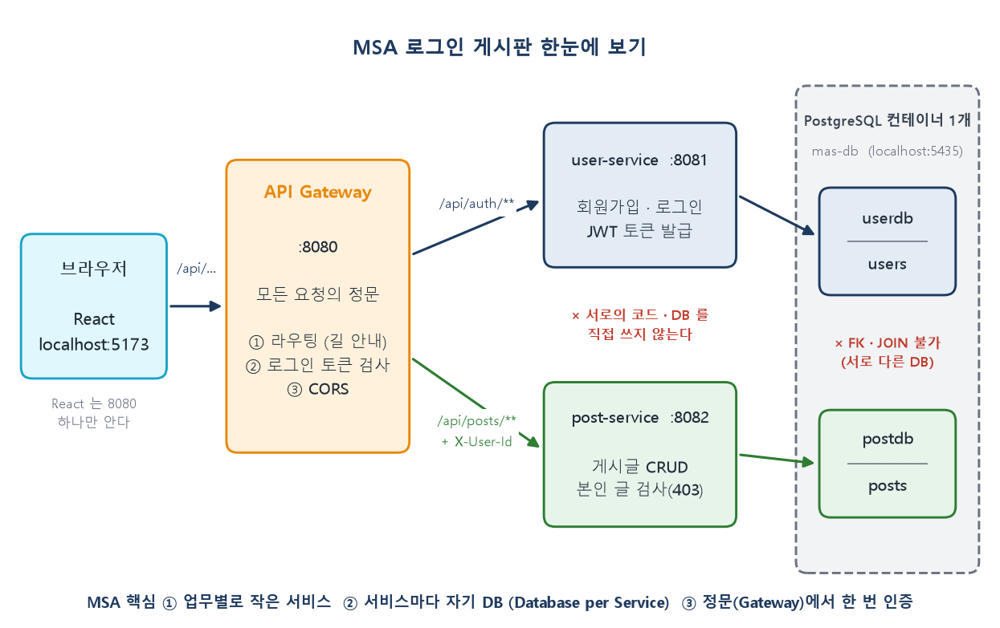
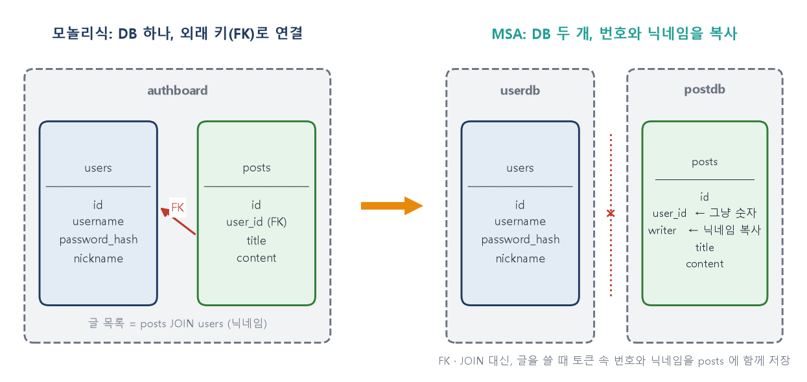

# React + Spring Boot MSA + PostgreSQL 학습 교안

React 심화 과정에서 만든 **로그인 게시판(CRUD + JWT 로그인)** 의 서버를
**MSA(마이크로서비스 아키텍처)** 로 나눠 보는 교안과 실습 코드입니다.



- **API Gateway (8080)** - 모든 요청의 정문. 라우팅, 로그인 토큰 검사, CORS
- **user-service (8081)** - 회원가입 · 로그인 · JWT 발급 → `userdb`
- **post-service (8082)** - 게시글 CRUD · 본인 글 검사 → `postdb`
- **PostgreSQL 컨테이너 1개, 데이터베이스 2개** (Database per Service, FK · JOIN 없음)

**웹 교안: https://sinaboro.github.io/react-spring-mas-postgresql/** (PC·휴대폰에서 장별로 읽기, 코드 복사 단추)

**교안 PDF: [docs/React_Spring_MSA_학습교안.pdf](docs/React_Spring_MSA_학습교안.pdf)** (60쪽, 권장 8시간)

> 모놀리식 원본(서버 1개): https://github.com/sinaboro/react-spring-postgresql (`advanced/board`)
> React 코드와 API 모양(JSON)은 원본과 같고, 서버만 MSA 로 나뉘었습니다.

## 모놀리식 → MSA, 무엇이 바뀌나

| | 모놀리식 (원본) | MSA (이 저장소) |
|---|---|---|
| 서버 | Spring Boot 1개 (8080) | 게이트웨이(8080) + user-service(8081) + post-service(8082) |
| DB | `authboard` 1개 (users, posts, FK) | `userdb`(users) + `postdb`(posts), 컨테이너 1개 (5435) |
| 작성자 | `@ManyToOne User author` (FK, JOIN) | `user_id` + `writer`(닉네임 복사), FK 없음 |
| 로그인 검사 | Spring Security + JWT 필터 | 게이트웨이 `AuthFilter` 한 곳 → `X-User-Id`, `X-User-Nickname` 헤더 |
| 토큰 | 발급 · 검사 모두 서버 하나 | 발급은 user-service, 검사는 게이트웨이 (같은 `jwt.secret`) |
| 401 / 403 | Security / PostService | 게이트웨이 / post-service |
| 서비스 하나가 꺼지면 | 전체 멈춤 | 그 기능만 멈춤 (게이트웨이가 503 으로 알림) |



## 폴더 구성

```text
docker-compose.yml           PostgreSQL 18 (localhost:5435, 컨테이너 mas-db)
db/init.sql                  userdb, postdb 만들기 (처음 켤 때 한 번 실행)
backend/                     IntelliJ 로 이 폴더를 연다 (Gradle 멀티 프로젝트)
  api-gateway/                 Spring Cloud Gateway (8080) - AuthFilter, JwtChecker, GatewayErrorHandler
  user-service/                회원 (8081) - User, AuthController, AuthService, JwtProvider
  post-service/                게시글 (8082) - Post, PostController, PostService
frontend/                    React + React Router + AuthContext (5173)
docs/
  guide/                     교안 원고 (Markdown, 0~8장 + 부록) + 웹 교안 장별 화면(ch00.html …)
  index.html                 웹 교안 첫 화면 (GitHub Pages: main 브랜치 /docs)
  images/                    개념 그림(fig_*)과 실행 화면(s*)
  React_Spring_MSA_학습교안.pdf
tools/
  make_figures.py            개념 그림 만들기
  build_guide.py             원고 → PDF (코드 상자는 저장소의 실제 파일로 자동 채움)
  build_site.py              원고 → 웹 교안 (docs/index.html, docs/guide/*.html)
```

## 실행 환경

- Node.js 22 이상, **JDK 21**, **IntelliJ IDEA**, Docker Desktop, VS Code, Git
- 확인한 버전: Spring Boot 4.1.2, Spring Cloud 2025.1.5 (Gateway), Gradle 9.9.1, jjwt 0.13, springdoc 3.2, PostgreSQL 18, React 19, Vite 8

## 빠르게 실행해 보기

```powershell
# 1) DB (저장소 폴더에서)
docker compose up -d
```

2) 서비스 3개: IntelliJ IDEA 에서 **File → Open → `backend`** → Gradle sync 가 끝나면 아래 세 파일을 열어 각각 ▶ 실행

| 서비스 | 파일 | 확인 |
|---|---|---|
| user-service | `user-service/.../UserServiceApplication.java` | http://localhost:8081/docs |
| post-service | `post-service/.../PostServiceApplication.java` | http://localhost:8082/docs |
| api-gateway | `api-gateway/.../GatewayApplication.java` | http://localhost:8080/api/posts |

(터미널에서는 `backend` 폴더에서 터미널 3개로 `.\gradlew.bat :user-service:bootRun`, `:post-service:bootRun`, `:api-gateway:bootRun`)

```powershell
# 3) React (새 터미널)
cd frontend
npm install
npm run dev                        # http://localhost:5173
```

> 원본 저장소의 게시판 서버도 8080 을 쓰므로 함께 켜지 않습니다.

## 교안 다시 만들기

```powershell
pip install reportlab matplotlib markdown
python tools/make_figures.py       # 개념 그림
python tools/build_guide.py        # docs/React_Spring_MSA_학습교안.pdf
python tools/build_site.py         # 웹 교안 (README 의 첫 문단·비교 표·폴더 구성을 읽어 쓴다)
```

강사 김대철
