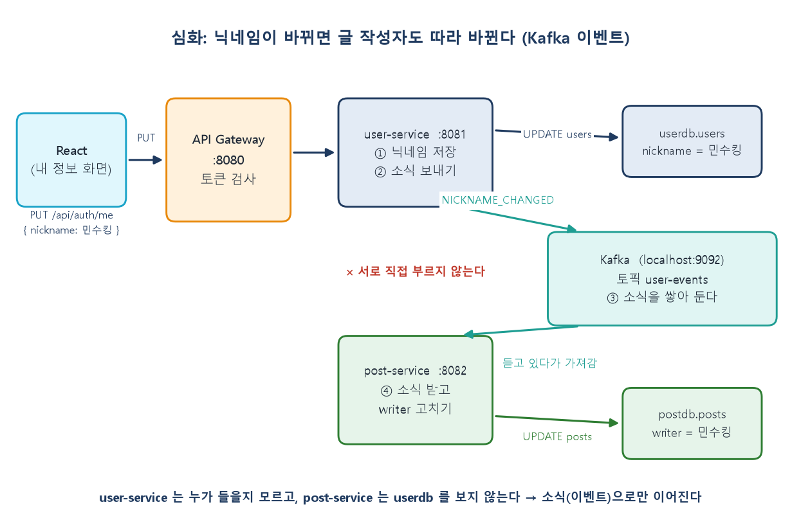

# 0장. 심화 과정 안내

## 심화 과정 한눈에 보기

기초 과정에서 로그인 게시판을 **게이트웨이 + user-service + post-service** 로 나누고, 서비스마다 자기 DB 를 두었다. 그 대가로 `posts.writer` 에 닉네임을 **복사**해 두었고, "닉네임을 바꿔도 예전 글의 작성자는 그대로" 라는 문제가 남았다(기초 5장).

심화 과정에서는 이 문제를 **Kafka 이벤트**로 푼다. 완성된 모습부터 보자.



1. React 의 **내 정보** 화면에서 닉네임을 바꾼다 → 게이트웨이 → **user-service** 가 `userdb.users` 를 고친다.
2. user-service 는 "1번 회원 닉네임이 민수킹으로 바뀌었어요" 라는 **소식(이벤트)** 을 **Kafka** 에 올려 둔다.
3. Kafka 는 소식을 **토픽**(`user-events`)에 차례대로 쌓아 둔다.
4. 이 토픽을 듣고 있던 **post-service** 가 소식을 가져가 `postdb.posts` 의 `writer` 를 고친다.

> **[MSA 개념] 이 과정에서 배우는 것**
>
> ① **이벤트로 이어지는 서비스**: user-service 는 post-service 를 부르지 않는다. 소식만 남긴다.
>
> ② **복사본 맞추기**: 나뉜 DB 의 복사본(`writer`)을 이벤트로 원본(`nickname`)과 맞춘다.
>
> ③ **결과적 일관성**: 아주 잠깐(1초 남짓) 두 DB 가 다를 수 있지만 결국 같아진다.
>
> ④ **놓친 소식 따라잡기**: post-service 가 꺼져 있던 동안의 소식도, 다시 켜지면 이어서 읽는다.

## 기초 과정과 무엇이 다른가

> **낱말 정리** - 이 교안에서 "**기초 과정**" 은 MSA 기초 교안(`React_Spring_MSA_기초_학습교안.pdf`), "**심화 과정**" 은 이 교안을 말한다. 로그인 게시판을 처음 만든 원본 과정은 "**React 심화 과정**" 이라고 따로 부른다.

| | 기초 과정 | 심화 과정 |
|---|---|---|
| 실습 폴더 | 저장소 맨 위 (`backend`, `frontend`) | **`advanced/`** (`advanced/backend`, `advanced/frontend`) |
| 컨테이너 | PostgreSQL 1개 (`mas-db`, 5435) | PostgreSQL (`mas-adv-db`, **5436**) + **Kafka** (`mas-adv-kafka`, 9092) |
| 닉네임 바꾸기 | 없음 | `PUT /api/auth/me` + React **내 정보** 화면 |
| 서비스끼리 | 아무 연결 없음 | **Kafka 토픽 `user-events`** 로 소식을 주고받는다 |
| 바뀐 파일 | - | user-service 8개(새 파일 3), post-service 6개(새 파일 2), React 5개 + 새 화면 1개 (2장 표) |
| 게이트웨이 | - | **바뀐 것 없음** |

기초 과정의 코드는 그대로 두었다. 심화 과정은 `advanced/` 폴더에 기초 코드를 복사한 뒤 Kafka 부분만 더한 것이다. 두 과정은 DB 포트와 컨테이너 이름이 달라 데이터가 섞이지 않는다. (서비스 포트 8080~8082 는 같으므로 한 번에 한 과정만 켠다)

## 진행 순서 (권장 8시간)

| 장 | 내용 | 시간 |
|---|---|---|
| 0장 | 심화 과정 안내 | 0.5 |
| 1장 | 이벤트와 Kafka - 왜 필요하고 무엇인가 | 1.5 |
| 2장 | 준비 - DB 와 Kafka 켜기, 프로젝트 열기 | 0.5 |
| 3장 | user-service - 닉네임 바꾸기와 이벤트 보내기 | 1.5 |
| 4장 | post-service - 이벤트 받아 writer 고치기 | 1 |
| 5장 | React - 내 정보 화면 | 0.5 |
| 6장 | 실험 - 따라잡기 · 옛 토큰 · Kafka 가 꺼지면 | 1.5 |
| 7장 | 정리와 더 나아가기 - Outbox, 탈퇴 이벤트, Redis | 1 |

장마다 **개념 → 코드 읽기 → 실행해서 확인 → 확인 문제** 순서다. 풀이는 부록 B 에 있다.

## 0-1. 준비

**먼저 기초 과정을 마친다.** 이 과정은 기초 과정의 코드와 낱말(게이트웨이, `X-User-Id`, Database per Service, 데이터 복제)을 알고 있다고 보고 진행한다.

**필요한 것** - 기초 과정과 같다 (Node.js, JDK 21, IntelliJ IDEA, Docker Desktop, Git). Kafka 는 Docker 로 켜므로 따로 설치하지 않는다. 메모리는 기초 과정보다 400MB 쯤 더 쓴다.

**[PS]** 저장소가 이미 있으면 최신으로 받는다

```powershell
cd C:\study\react-spring-mas-postgresql   # 기초 과정에서 받은 저장소 폴더
git pull                                   # GitHub 의 최신 코드로 맞추기 (내가 고친 파일이 있으면 충돌할 수 있다 → 부록 A)
cd advanced                                # 심화 실습 폴더 (이후 [PS] 명령의 기준)
```

**폴더 구성**

```text
advanced/
├─ docker-compose.yml        PostgreSQL 18 (localhost:5436) + Kafka (localhost:9092)
├─ db/init.sql               userdb, postdb 만들기 (기초와 같음)
├─ backend/                  ← IntelliJ 로 이 폴더를 연다
│   ├─ api-gateway/            기초와 같음
│   ├─ user-service/           + 닉네임 바꾸기, UserEventPublisher (소식 보내기)
│   └─ post-service/           + UserEventListener (소식 받기)
└─ frontend/                 + 내 정보 화면 (ProfilePage)
```

## 정리

- 심화 과정은 기초 과정의 "복사본이 원본과 달라지는 문제" 를 **Kafka 이벤트**로 푼다.
- 실습은 `advanced/` 폴더에서 한다. DB 는 5436, Kafka 는 9092 를 쓴다.
- 게이트웨이는 그대로이고, user-service · post-service · React 에 조금씩 더한다.
