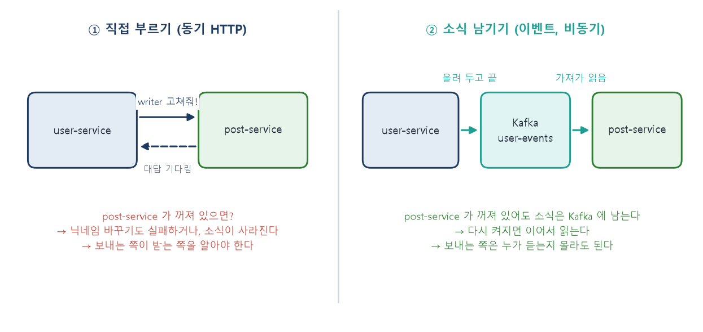
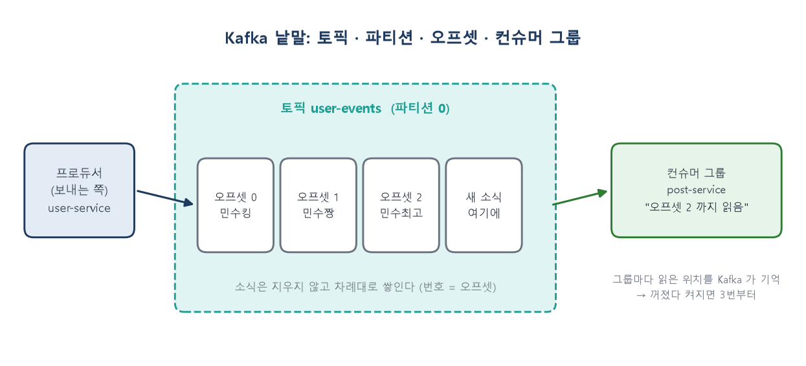

# 1장. 이벤트와 Kafka - 왜 필요하고 무엇인가

## 학습 목표

- 나뉜 DB 의 복사본을 맞추는 두 방법(직접 부르기, 이벤트)을 비교할 수 있다.
- Kafka 의 낱말(브로커, 토픽, 파티션, 키, 오프셋, 프로듀서, 컨슈머, 컨슈머 그룹)을 설명할 수 있다.
- **결과적 일관성**이 무엇인지, 왜 MSA 에서 받아들이는지 안다.

## 1-1. 문제 다시 보기

기초 5장에서 `posts` 테이블에 닉네임을 복사해 두었다.

```text
userdb.users             postdb.posts
id | nickname            id | user_id | writer | title
 1 | 민수        ──복사──▶  1 |    1    | 민수   | 첫 글
```

이제 민수가 닉네임을 "민수킹" 으로 바꾼다. `users` 는 user-service 가 고치지만, `posts.writer` 는 다른 서비스의 다른 DB 에 있다. user-service 는 `postdb` 에 접속할 수 없다(Database per Service). **누가, 어떻게** `writer` 를 고쳐야 할까?

## 1-2. 방법 두 가지



**① 직접 부르기 (동기 HTTP)** - user-service 가 post-service 의 API 를 불러 "1번 회원 글의 writer 를 민수킹으로 고쳐 줘" 라고 한다.

- user-service 가 **post-service 의 주소와 API 를 알아야** 한다. 나중에 댓글 서비스가 생기면 댓글 서비스도 불러야 한다. 서비스가 늘수록 user-service 코드가 바뀐다.
- post-service 가 **꺼져 있으면** 부르기가 실패한다. 닉네임 바꾸기 자체를 실패로 할까? 아니면 실패를 무시하고 넘어갈까(그러면 그 소식은 영영 사라진다)?
- 대답이 올 때까지 **기다린다**. post-service 가 느리면 닉네임 바꾸기도 느려진다.

**② 소식 남기기 (이벤트, 비동기)** - user-service 는 "1번 회원 닉네임이 민수킹으로 바뀌었어요" 라는 **사실**만 Kafka 에 올려 두고 끝낸다. 듣고 싶은 서비스가 각자 가져가 읽는다.

- user-service 는 **누가 듣는지 모른다**. 댓글 서비스가 생겨도 user-service 는 고칠 것이 없다. 댓글 서비스가 같은 토픽을 들으면 된다.
- post-service 가 꺼져 있어도 **소식은 Kafka 에 남는다**. 다시 켜지면 이어서 읽는다.
- 기다리지 않는다. 대신 posts 가 고쳐지는 것은 **조금 뒤**다.

> **[MSA 개념] 명령이 아니라 사실을 알린다**
>
> ① 은 "writer 를 고쳐라" 라는 **명령**이고, ② 는 "닉네임이 바뀌었다" 라는 **사실(이벤트)** 이다. 사실을 듣고 무엇을 할지는 받는 쪽이 정한다. post-service 는 writer 를 고치고, 나중에 생길 알림 서비스는 "닉네임이 바뀌었어요" 알림을 보낼 수도 있다. 보내는 쪽과 받는 쪽이 서로를 모르는 이 상태를 **느슨한 연결(loose coupling)** 이라고 한다.

## 1-3. Kafka 는 무엇인가

**Kafka** 는 서비스들이 소식(메시지)을 올려 두고 가져가 읽는 **우체국 같은 프로그램**이다. 정확히는 "메시지 브로커(broker, 중개인)" 또는 "이벤트 스트리밍 플랫폼" 이라고 부른다.



| 낱말 | 뜻 | 이 과정에서 |
|---|---|---|
| **브로커** | Kafka 서버 한 대 | `mas-adv-kafka` 컨테이너 1대 (localhost:9092) |
| **토픽** | 소식을 모아 두는 이름 붙은 게시판 | `user-events` |
| **파티션** | 토픽을 나눈 칸. 칸 안에서는 들어온 **순서가 지켜진다** | 1칸 (파티션 0) |
| **키** | 소식에 붙이는 이름표. 같은 키는 **같은 칸**에 들어간다 | 회원 번호 `"1"` |
| **오프셋** | 칸 안에서 소식의 순번 (0, 1, 2 ...) | |
| **프로듀서** | 소식을 보내는 쪽 | user-service (`UserEventPublisher`) |
| **컨슈머** | 소식을 읽는 쪽 | post-service (`UserEventListener`) |
| **컨슈머 그룹** | 함께 읽는 컨슈머 묶음. Kafka 는 **그룹마다 어디까지 읽었는지(오프셋)** 를 기억한다 | `post-service` |

**Kafka 는 읽은 소식을 지우지 않는다.** 일반 우체국은 편지를 가져가면 끝이지만, Kafka 는 소식을 보관 기간(기본 7일) 동안 남겨 두고 "그룹마다 몇 번까지 읽었는지" 만 따로 적어 둔다. 그래서

- post-service 가 꺼졌다 켜지면 **적어 둔 위치 다음부터** 이어 읽는다.
- 다른 그룹(예: 나중에 생길 `comment-service`)은 같은 소식을 **처음부터 따로** 읽을 수 있다.

> **키를 회원 번호로 붙이는 이유**
>
> 민수가 닉네임을 "민수킹" → "민수짱" 으로 빠르게 두 번 바꿨다. 두 소식이 거꾸로 처리되면 최종 writer 가 "민수킹" 이 되어 버린다. 같은 키의 소식은 같은 파티션에 들어가 **보낸 순서대로** 읽히므로, 한 회원의 소식은 순서가 뒤바뀌지 않는다.
>
> 이 과정의 토픽은 파티션이 **1칸**뿐이라 키가 없어도 순서가 지켜진다. 키가 힘을 쓰는 것은 바쁜 서비스에서 파티션을 여러 칸으로 늘려 여러 컨슈머가 나눠 읽을 때다. 그때도 같은 회원의 소식은 같은 칸으로 모인다. 미리 키를 붙여 두면 나중에 칸을 늘려도 코드를 고칠 필요가 없다. (7장 도전 과제 4)

## 1-4. 결과적 일관성

닉네임을 바꾼 바로 그 순간에는 `users.nickname` 은 "민수킹", `posts.writer` 는 아직 "민수" 다. 소식이 도착하는 1초 남짓 동안 두 DB 가 **다르다**. 그리고 곧 같아진다.

이렇게 "**지금 당장은 아니어도, 결국에는 맞춰진다**" 를 **결과적 일관성(eventual consistency)** 이라고 한다. 모놀리식의 `@Transactional` 처럼 "두 테이블을 동시에 바꾸고, 하나라도 실패하면 둘 다 되돌린다" 는 **강한 일관성**은 DB 가 나뉜 MSA 에서 얻기 어렵다.

> **[MSA 개념] 언제 결과적 일관성을 받아들일까?**
>
> 글 목록의 작성자 이름이 1초 늦게 바뀌는 것은 아무도 문제 삼지 않는다. 반대로 "계좌에서 돈을 빼고 다른 계좌에 넣기" 처럼 잠깐이라도 어긋나면 안 되는 일은 서비스를 나누지 않거나, 훨씬 복잡한 방법(Saga 패턴, 7장)을 쓴다. **업무가 얼마나 기다려 줄 수 있는가**로 정한다.

## 정리

- 나뉜 DB 의 복사본은 **직접 부르기** 또는 **이벤트**로 맞춘다. 이 과정은 이벤트를 쓴다.
- Kafka 는 소식을 **토픽**에 쌓아 두는 브로커다. 읽어도 지우지 않고, **컨슈머 그룹마다 읽은 위치(오프셋)** 를 기억한다.
- 같은 **키**의 소식은 같은 파티션에 들어가 순서가 지켜진다.
- 이벤트로 맞추면 잠깐 어긋났다가 결국 같아진다(**결과적 일관성**).

## 확인 문제

1. user-service 가 post-service 를 직접 부르는 방법의 단점 두 가지를 말해 보자.
2. Kafka 는 컨슈머가 읽은 소식을 지우는가? 그 덕분에 무엇을 할 수 있는가?
3. 이벤트의 키로 회원 번호를 쓰는 이유는?
4. "결과적 일관성" 을 내 말로 설명해 보자. 게시판의 작성자 이름에는 괜찮은데, 어떤 업무에는 곤란할까?
