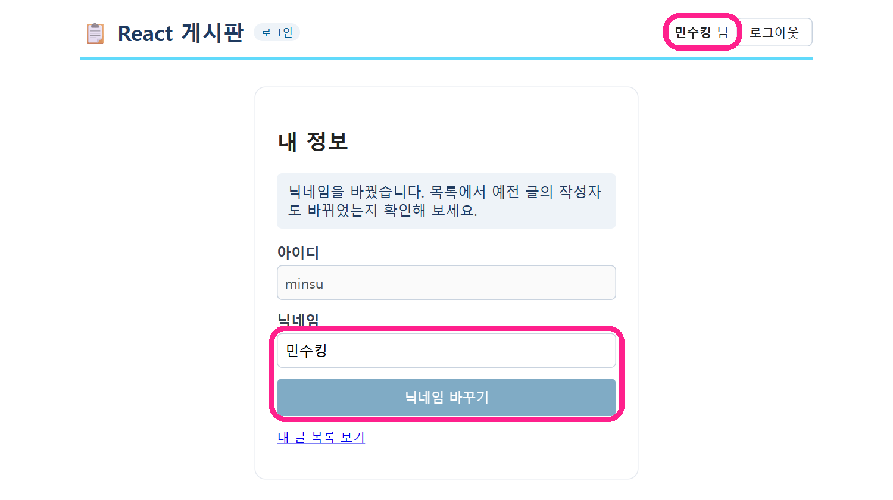

# 5장. React - 내 정보 화면

## 학습 목표

- 닉네임 바꾸기 API 를 부르는 함수와 화면을 더한다.
- 서버가 돌려준 **새 토큰**으로 바꿔 끼우는 이유를 React 쪽에서 확인한다.

## 5-1. 무엇을 더하나

| 파일 | 더한 것 |
|---|---|
| `api.js` | `updateMe(nickname)` → `PUT /api/auth/me` |
| `context/AuthContext.jsx` | `changeNickname(nickname)` → 새 토큰 저장 + `user` 바꾸기 |
| **새** `pages/ProfilePage.jsx` | 내 정보 화면 (`/me`) |
| `App.jsx` | `/me` 주소 (로그인한 사람만, `ProtectedRoute`) |
| `components/Layout.jsx`, `App.css` | 머리글의 "닉네임 님" 을 누르면 `/me` 로 |

React 쪽은 MSA 와 상관없이 지금까지 배운 그대로다. 주소는 여전히 게이트웨이(8080) 하나다.

## 5-2. api.js 와 AuthContext

```javascript
// api.js - (심화) 닉네임 바꾸기 → { access_token(새 토큰), user }
export const updateMe = (nickname) => request("/auth/me", { method: "PUT", body: { nickname } });
```

```javascript
// AuthContext.jsx - (심화) 닉네임 바꾸기 - 서버가 돌려준 "새 토큰" 으로 바꿔 끼운다
//   옛 토큰 안에는 옛 닉네임이 들어 있어서, 그대로 쓰면 새 글도 옛 닉네임으로 저장된다.
const changeNickname = async (nickname) => {
  const data = await api.updateMe(nickname);
  api.tokenStore.set(data.access_token); // ← 새 토큰으로 교체
  setUser(data.user); //                    ← 머리글의 "닉네임 님" 이 바로 바뀐다
};
```

`changeNickname` 을 Context 의 값에 함께 넣어 두면(`value={{ user, login, logout, signup, changeNickname }}`) 어느 화면에서든 `useAuth()` 로 꺼내 쓸 수 있다.

## 5-3. ProfilePage

<!-- file: advanced/frontend/src/pages/ProfilePage.jsx -->

```jsx
// ProfilePage.jsx - (심화) 내 정보 · 닉네임 바꾸기 ( /me )
//
// 이 파일이 보여 주는 것
//   - 닉네임을 바꾸면 PUT /api/auth/me → 게이트웨이 → user-service (userdb 의 users 를 고친다)
//   - 그러면 내가 예전에 쓴 글의 작성자도 바뀔까?
//       Kafka 가 꺼져 있으면(app.kafka.enabled=false) → 안 바뀐다. posts.writer 는 복사본이기 때문
//       Kafka 가 켜져 있으면 → user-service 가 보낸 소식을 post-service 가 받아 writer 를 고친다
//     목록으로 가서 직접 확인해 보자. (소식이 도착하는 데 1초쯤 걸릴 수 있다)

import { useState } from "react";
import { Link } from "react-router";
import { useAuth } from "../context/AuthContext";

function ProfilePage() {
  const { user, changeNickname } = useAuth();
  const [nickname, setNickname] = useState(user.nickname); // ProtectedRoute 안이라 user 는 항상 있다
  const [message, setMessage] = useState(null);
  const [error, setError] = useState(null);
  const [busy, setBusy] = useState(false);

  const handleSubmit = async (e) => {
    e.preventDefault();
    setBusy(true);
    setError(null);
    setMessage(null);
    try {
      await changeNickname(nickname.trim());
      setMessage("닉네임을 바꿨습니다. 목록에서 예전 글의 작성자도 바뀌었는지 확인해 보세요.");
    } catch (err) {
      setError(err.message); // "닉네임을 입력하세요" 등
    } finally {
      setBusy(false);
    }
  };

  return (
    <form className="post-form auth-form" onSubmit={handleSubmit}>
      <h2>내 정보</h2>
      {message && <p className="info-box">{message}</p>}
      {error && <p className="error">⚠️ {error}</p>}
      <label>
        아이디
        <input value={user.username} disabled />
      </label>
      <label>
        닉네임
        <input value={nickname} onChange={(e) => setNickname(e.target.value)} maxLength={30} />
      </label>
      <button type="submit" className="primary wide" disabled={busy || !nickname.trim() || nickname === user.nickname}>
        {busy ? "바꾸는 중..." : "닉네임 바꾸기"}
      </button>
      <p className="hint">
        <Link to="/?mine=1">내 글 목록 보기</Link>
      </p>
    </form>
  );
}

export default ProfilePage;
```

- 닉네임 입력 칸의 처음 값은 지금 닉네임(`user.nickname`)이다.
- 지금과 같은 값이거나 비어 있으면 **바꾸기 단추를 막는다**(`disabled`). 쓸데없는 이벤트가 나가지 않게 하는 화면 쪽 배려다.
- 오류 메시지(`닉네임을 입력하세요` 등)는 user-service 의 `{"detail": ...}` 를 그대로 보여 준다.

`App.jsx` 에는 `/me` 를 `ProtectedRoute` 로 감싸 더했고, `Layout.jsx` 에서는 머리글의 닉네임을 `<Link to="/me">` 로 바꿨다.

## 5-4. 켜서 확인하기

**[PS]** 새 터미널에서 (처음 한 번만 `npm install`. 기초 과정의 `frontend` 가 아니라 **`advanced\frontend`** 다)

```powershell
cd C:\study\react-spring-mas-postgresql\advanced\frontend
npm install
npm run dev
```

게이트웨이까지 켠 상태에서 http://localhost:5173 → 로그인 → 머리글의 **닉네임**을 누르면 내 정보 화면이 열린다. 닉네임을 바꾸고 **닉네임 바꾸기**를 누른다.



목록에서 예전 글의 작성자가 바뀌었는지는 6장에서 차근차근 확인한다.

## 정리

- `updateMe` → `PUT /api/auth/me`, `changeNickname` 이 **새 토큰**을 저장하고 `user` 를 바꾼다.
- 내 정보 화면은 `/me`, 로그인한 사람만 들어온다.
- React 는 게이트웨이 주소 하나만 알면 된다. Kafka 가 있는지도 모른다.

## 확인 문제

1. `changeNickname` 에서 `api.tokenStore.set(data.access_token)` 을 빼면 어떻게 될까?
2. React 는 Kafka 를 알아야 하는가? 이유는?
