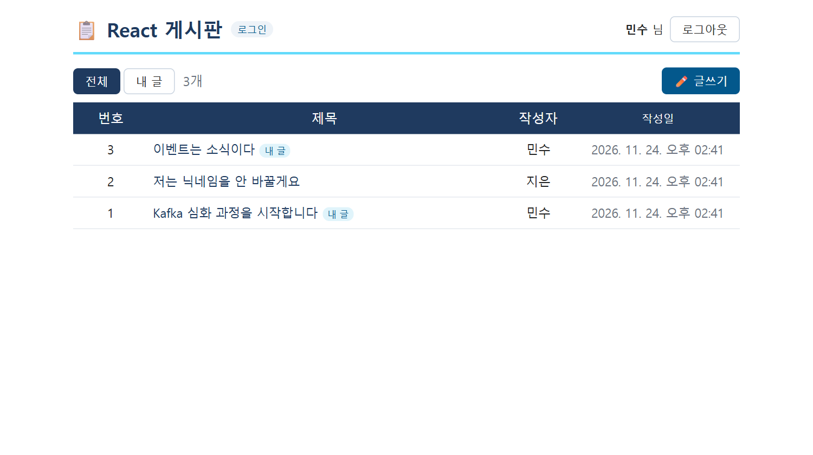
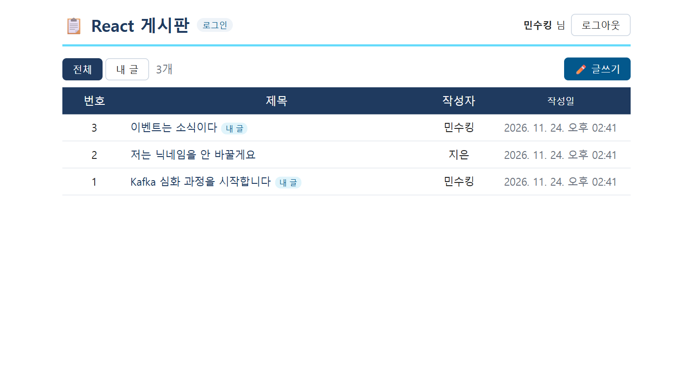

# 6장. 실험 - 따라잡기 · 옛 토큰 · Kafka 가 꺼지면

## 학습 목표

- 전체를 켜고 닉네임을 바꿔 글 작성자가 따라 바뀌는 것을 확인한다.
- post-service 가 꺼져 있던 동안의 소식을 **따라잡는** 것을 확인한다.
- 옛 토큰, Kafka 장애처럼 **이벤트 방식의 약한 곳**을 직접 겪어 본다.

## 6-1. 켜는 순서

| 순서 | 무엇을 | 어떻게 |
|---|---|---|
| 1 | DB + Kafka | `advanced` 폴더에서 `docker compose up -d` |
| 2 | user-service, post-service, api-gateway | IntelliJ (`advanced\backend`) 에서 각각 ▶ |
| 3 | React | `advanced\frontend` 에서 `npm run dev` |

기초 과정과 같은 순서이고, **Kafka 를 DB 와 함께 먼저** 켠다는 것만 다르다.

**[PS]** 실험에 쓸 준비 - 기초 과정(4장·7장)에서 쓴 `Show-Error` 함수를 다시 만들고, 두 사람을 가입시킨다. (React 화면으로 가입해도 된다)

```powershell
function Show-Error($err) {
  if ($err.ErrorDetails.Message) { $body = $err.ErrorDetails.Message }
  else {
    $reader = New-Object System.IO.StreamReader($err.Exception.Response.GetResponseStream(), [System.Text.Encoding]::UTF8)
    $body = $reader.ReadToEnd()
  }
  "$([int]$err.Exception.Response.StatusCode) $body"
}
$api = "http://localhost:8080/api"
$json = "application/json; charset=utf-8"
try { Invoke-RestMethod -Method Post -Uri "$api/auth/signup" -ContentType $json -Body '{"username":"minsu","password":"password123","nickname":"민수"}' } catch { Show-Error $_ }
try { Invoke-RestMethod -Method Post -Uri "$api/auth/signup" -ContentType $json -Body '{"username":"jieun","password":"password123","nickname":"지은"}' } catch { Show-Error $_ }
```

(3장에서 minsu 를 이미 만들었다면 `409 이미 사용 중인 아이디입니다` 가 나온다. 괜찮다)

## 6-2. 실험 ① 닉네임을 바꾸면 글 작성자도 바뀐다

React 에서 **민수로 로그인**해 글을 두 개, **지은으로 로그인**해 글을 하나 쓴다. 다시 민수로 로그인한다.



머리글의 **민수**를 눌러 내 정보 화면에서 닉네임을 `민수킹` 으로 바꾼다. 그리고 목록으로 간다.



이때 일어난 일을 콘솔에서 따라가 보자.

```text
[user-service] [이벤트 보냄] user-events → {"type":"NICKNAME_CHANGED","userId":1,"nickname":"민수킹"}
[post-service] [이벤트 받음] 1번 회원 닉네임 → 민수킹 (글 2개 고침)
```

user-service 는 post-service 를 부르지 않았고, post-service 는 userdb 를 보지 않았다. **Kafka 에 남긴 소식 하나로** 두 DB 가 같아졌다.

> **목록에 아직 옛 이름이 보인다면?** 소식이 도착하기 전(1초 남짓)에 목록을 불러온 것이다. 잠시 뒤 다시 열면 바뀌어 있다. 1장에서 배운 **결과적 일관성**이다.

## 6-3. 실험 ② post-service 가 꺼져 있을 때 바꾸면

IntelliJ 의 Services 창에서 **post-service 만 멈춘다**(■). 그리고 닉네임을 `민수짱` 으로 바꾼다.

**[PS]**

```powershell
$login = Invoke-RestMethod -Method Post -Uri "$api/auth/login" -ContentType $json -Body '{"username":"minsu","password":"password123"}'
$headers = @{ Authorization = "Bearer " + $login.access_token }
$res = Invoke-RestMethod -Method Put -Uri "$api/auth/me" -Headers $headers -ContentType $json -Body '{"nickname":"민수짱"}'
$res.user
docker exec mas-adv-kafka /opt/kafka/bin/kafka-consumer-groups.sh --bootstrap-server localhost:9092 --describe --group post-service
```

```text
id username nickname
-- -------- --------
 1 minsu    민수짱

GROUP         TOPIC        PARTITION  CURRENT-OFFSET  LOG-END-OFFSET  LAG  CONSUMER-ID
post-service  user-events  0          2               3               1    -
```

- 닉네임 바꾸기는 **성공**했다. user-service 는 post-service 가 꺼진 것을 모르고, 알 필요도 없다.
- `LAG` 이 **1** - post-service 그룹이 아직 읽지 않은 소식이 하나 쌓여 있다. `CONSUMER-ID` 가 `-` 인 것은 지금 붙어 있는 post-service 가 없다는 뜻이다.
- 이 상태에서 글 목록은 503 이다(post-service 가 꺼져 있으므로).

이제 post-service 를 다시 켠다(▶). 켜지자마자 콘솔에 이 줄이 나온다.

```text
[이벤트 받음] 1번 회원 닉네임 → 민수짱 (글 2개 고침)
```

다시 `kafka-consumer-groups.sh` 를 실행하면 `LAG` 이 0 이다. **꺼져 있던 동안의 소식을 따라잡았다.**

> **[MSA 개념] 이것이 이벤트 방식을 쓰는 가장 큰 이유**
>
> 직접 부르기(1장 ①)였다면 post-service 가 꺼진 순간 그 요청은 실패했고, 소식은 사라졌다. Kafka 는 소식을 보관하고 "어디까지 읽었는지" 를 기억하므로, 받는 쪽이 잠깐 죽어도 **나중에 맞춰진다**. 보내는 쪽과 받는 쪽이 **동시에 살아 있지 않아도** 된다.

## 6-4. 실험 ③ 옛 토큰으로 글을 쓰면

닉네임을 바꾸기 **전에** 받은 토큰이 아직 남아 있다면? 실험 ②의 `$headers` 는 `민수` → `민수짱` 으로 바꾸기 **전**에 로그인해 받은 토큰이다. (토큰 안의 닉네임은 그 앞 단계의 `민수킹`)

**[PS]**

```powershell
$old = Invoke-RestMethod -Method Post -Uri "$api/posts" -Headers $headers -ContentType $json -Body '{"title":"옛 토큰으로 쓴 글"}'
$old.writer
$new = Invoke-RestMethod -Method Post -Uri "$api/posts" -Headers @{ Authorization = "Bearer " + $res.access_token } -ContentType $json -Body '{"title":"새 토큰으로 쓴 글"}'
$new.writer
```

```text
민수킹
민수짱
```

옛 토큰으로 쓴 글은 **옛 닉네임**으로 저장됐다. 게이트웨이는 토큰 안의 닉네임을 그대로 `X-User-Nickname` 으로 넘기기 때문이다. 그래서 3장에서 닉네임을 바꿀 때 **새 토큰**을 돌려주고, React 가 바꿔 끼우게 했다.

> **그래도 옛 토큰이 남는 경우** - 같은 계정으로 다른 브라우저(휴대폰)에서도 로그인해 있었다면 그쪽 토큰은 여전히 옛 닉네임이다. 이 과정은 다음 닉네임 변경 소식이 오면 다시 맞춰지는 정도로 둔다. 완전히 막으려면 토큰에 닉네임을 넣지 않고 post-service 가 닉네임을 따로 관리하거나(이벤트로 받아 둔 "회원 번호 → 닉네임" 표), 옛 토큰을 거부하는 방법(7장 Redis)이 필요하다.

## 6-5. 실험 ④ Kafka 가 꺼지면

**[PS]** `advanced` 폴더에서 Kafka 만 멈추고, 닉네임을 바꿔 본다

```powershell
docker compose stop kafka
Measure-Command { $res2 = Invoke-RestMethod -Method Put -Uri "$api/auth/me" -Headers @{ Authorization = "Bearer " + $res.access_token } -ContentType $json -Body '{"nickname":"카프카없음"}' } | Select-Object TotalSeconds
$res2.user.nickname
```

```text
TotalSeconds
------------
   3.4129381

카프카없음
```

- 닉네임 바꾸기는 **성공**했지만 **3초쯤** 걸렸다. user-service 가 Kafka 를 3초(`max.block.ms`) 기다리다 포기했기 때문이다.
- user-service 콘솔: `[이벤트 실패] Kafka 에 연결할 수 없습니다: ...`
- post-service 콘솔에도 Kafka 에 붙지 못한다는 경고가 계속 찍힌다. (Kafka 를 다시 켜면 멈춘다)

이제 Kafka 를 다시 켜 보자.

**[PS]**

```powershell
docker compose start kafka
```

post-service 가 Kafka 에 다시 붙지만, 글 작성자는 **여전히 `민수짱`** 이다. `카프카없음` 소식은 Kafka 에 **도착한 적이 없으므로** 기다려도 오지 않는다. users 는 `카프카없음`, posts 는 `민수짱` - **두 DB 가 영영 어긋났다.**

> **[MSA 개념] Kafka 도 장애가 날 수 있다**
>
> 실험 ②에서 받는 쪽이 꺼진 것은 Kafka 가 메워 줬다. 하지만 **보내는 순간** Kafka 에 닿지 못하면 소식은 사라진다. "DB 저장" 과 "Kafka 로 보내기" 는 서로 다른 시스템이라 하나의 트랜잭션으로 묶을 수 없기 때문이다. 이 문제를 푸는 대표적인 방법이 7장의 **Outbox 패턴**이다. 실제 운영에서는 Kafka 도 여러 대(브로커 3대 이상)로 띄워 한 대가 죽어도 멈추지 않게 한다.

실험이 끝나면 닉네임을 원래대로 돌려 두자. 닉네임을 다시 바꾸면 새 소식이 나가 posts 도 다시 맞춰진다.

> **스위치 `app.kafka.enabled` 로도 실험할 수 있다.** user-service 의 `application.yml` 에서 `app.kafka.enabled` 를 `false` 로 바꾸고 다시 켜면, 소식을 아예 보내지 않는다(콘솔: `[이벤트 꺼짐]`). 기초 과정처럼 "닉네임을 바꿔도 글 작성자는 그대로" 인 상태를 다시 볼 수 있다. 실험 뒤에는 `true` 로 되돌린다.

## 정리

- 닉네임을 바꾸면 Kafka 소식 하나로 posts 의 writer 까지 맞춰진다 (결과적 일관성).
- 받는 쪽(post-service)이 꺼져 있어도 소식은 Kafka 에 남고, 다시 켜지면 **따라잡는다** (`LAG` 이 0 이 된다).
- 옛 토큰에는 옛 닉네임이 있다 → 닉네임을 바꾸면 새 토큰으로 바꿔 끼운다.
- 보내는 순간 Kafka 가 꺼져 있으면 소식이 사라진다 → Outbox 패턴(7장).

## 확인 문제

1. 실험 ②에서 post-service 가 꺼져 있는 동안 `LAG` 이 1 이었다. 다시 켜면 왜 0 이 되는가?
2. 실험 ③에서 옛 토큰으로 쓴 글의 작성자가 옛 닉네임인 이유는?
3. 실험 ④에서 Kafka 를 다시 켰는데도 writer 가 맞춰지지 않은 이유는?
4. 실험 ②와 ④는 모두 "무언가가 꺼진" 상황이다. 결과가 다른 이유를 한 문장으로 설명해 보자.
