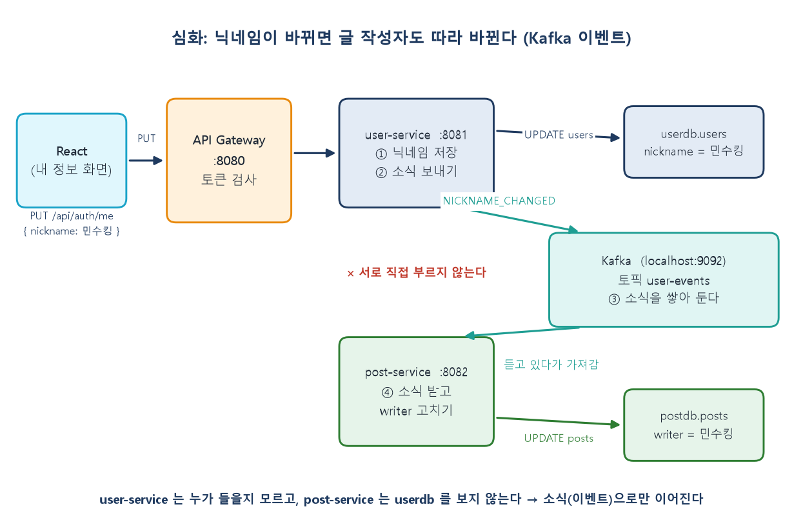
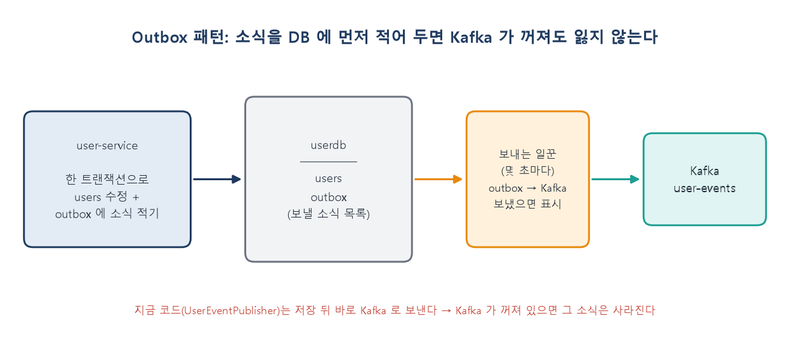

# 7장. 정리와 더 나아가기 - Outbox, 탈퇴 이벤트, Redis

## 학습 목표

- 심화 과정에서 더한 것을 한 장으로 정리한다.
- 6장 실험 ④의 약점을 푸는 **Outbox 패턴**의 생각을 안다.
- **Redis** 가 MSA 에서 어디에 쓰이는지 안다.

## 7-1. 한 장으로 다시 보기

| 질문 | 기초 과정 | 심화 과정 |
|---|---|---|
| 닉네임을 바꾸면 예전 글 작성자는? | 그대로 (복사본이 어긋남) | **Kafka 소식으로 따라 바뀐다** |
| 서비스끼리 어떻게 이어지나? | 이어지지 않음 | 토픽 `user-events` (user-service → post-service) |
| post-service 가 꺼져 있었다면? | - | 다시 켜지면 **따라잡는다** (컨슈머 그룹의 오프셋) |
| 같은 소식을 두 번 받으면? | - | 괜찮다 (writer 덮어쓰기는 **멱등**) |
| 두 DB 가 같아지는 시점은? | - | 잠깐 뒤 (**결과적 일관성**) |
| 약한 곳은? | - | 보내는 순간 Kafka 가 꺼져 있으면 소식이 사라진다 |

## 7-2. Outbox 패턴 - 소식을 잃지 않으려면

6장 실험 ④에서 Kafka 가 꺼져 있을 때 닉네임을 바꾸자 소식이 사라졌다. "users 저장" 은 PostgreSQL, "소식 보내기" 는 Kafka 라서 **하나의 트랜잭션으로 묶을 수 없기** 때문이다.

**Outbox(보낼 편지함) 패턴**은 이렇게 한다.

1. user-service 의 DB(userdb)에 `outbox` 테이블을 하나 만든다. (보낼 소식 목록)
2. 닉네임을 바꿀 때 **같은 트랜잭션**으로 `users` 를 고치고 `outbox` 에 소식 한 줄을 적는다. 같은 DB 라서 둘 다 되거나 둘 다 안 된다.
3. 따로 도는 **보내는 일꾼**(예: `@Scheduled` 로 몇 초마다)이 `outbox` 에서 아직 안 보낸 소식을 꺼내 Kafka 로 보내고, 보냈으면 "보냄" 으로 표시한다.
4. Kafka 가 꺼져 있으면 일꾼이 계속 실패하지만, 소식은 `outbox` 에 남아 있다. Kafka 가 돌아오면 그때 보낸다.

일꾼이 "보냈다" 표시를 하기 직전에 죽으면 같은 소식을 두 번 보낼 수 있다. 그래서 받는 쪽의 **멱등성**(4장)이 함께 필요하다. 실무에서는 DB 의 변경 기록을 읽어 Kafka 로 보내 주는 **Debezium** 같은 도구로 일꾼을 대신하기도 한다.

## 7-3. 다음 소식 - 회원 탈퇴

기초 5장에서 "회원이 탈퇴해도 DB 가 글을 함께 지워 주지 않는다(`ON DELETE CASCADE` 를 쓸 수 없다)" 고 했다. 이제 같은 방법으로 풀 수 있다.

| 단계 | 어디서 | 무엇을 |
|---|---|---|
| 1 | user-service | `DELETE /api/auth/me` → users 에서 삭제 |
| 2 | user-service | `{"type":"USER_DELETED","userId":1}` 소식 보내기 (같은 토픽) |
| 3 | post-service | `UserEventListener` 에서 `type` 이 `USER_DELETED` 면 그 회원 글 삭제 (또는 작성자를 "탈퇴한 회원" 으로) |

`UserEvent` 에 `type` 칸을 둔 덕분에 토픽도, 리스너도 새로 만들 필요 없이 `if` 하나만 더하면 된다. (도전 과제 1)

## 7-4. Redis 는 어디에 쓰나

Kafka 가 "서비스 사이에 **소식을 전하는**" 도구라면, **Redis** 는 "**아주 빠르게 잠깐 기억하는**" 메모리 저장소다. 주 DB(PostgreSQL)를 대신하지는 않는다. 이 게시판에 넣는다면 이런 곳이다.

| 쓰임 | 어디에 | 하는 일 |
|---|---|---|
| **로그아웃한 토큰 거부** | api-gateway | JWT 는 서버가 취소할 수 없다. 로그아웃(또는 닉네임 변경)한 토큰을 만료 시각까지 Redis 에 적어 두고, `AuthFilter` 가 그 목록에 있으면 401 로 막는다. 6장 실험 ③의 "옛 토큰" 문제도 이렇게 막을 수 있다 |
| **요청 수 제한** | api-gateway | "1초에 10번까지" 처럼 막기. Spring Cloud Gateway 의 `RequestRateLimiter` 가 Redis 에 횟수를 센다. 게이트웨이를 여러 대 띄워도 횟수를 함께 센다 |
| **캐시** | post-service | 자주 읽는 글 목록을 Redis 에 잠깐 담아 두고 DB 를 덜 읽는다. 글이 바뀌면 지운다 |
| **분산 락** | 여러 서비스 | 같은 일을 두 서버가 동시에 하지 않게 잠금 |

> **[MSA 개념] 도구는 문제가 생길 때 들인다**
>
> 기초 과정에는 Kafka 도 Redis 도 없었다. 복사본을 맞춰야 하는 문제(닉네임 변경)가 생기자 Kafka 를 들였다. Redis 도 "옛 토큰을 막아야 한다", "요청이 너무 많다" 같은 문제가 실제로 생길 때 들이면 된다. 도구가 늘수록 켜고, 지켜보고, 고장을 고칠 대상도 늘어난다.

## 7-5. Saga - 여러 서비스에 걸친 작업

"주문 → 결제 → 재고 차감" 처럼 **여러 서비스**를 거쳐야 하는 일은 하나의 트랜잭션으로 묶을 수 없다. **Saga 패턴**은 각 서비스가 자기 일을 하고 이벤트로 다음 서비스에 넘기며, 중간에 실패하면 앞에서 한 일을 **되돌리는 이벤트**(결제 취소, 주문 취소)를 보내 맞춘다. 이 과정의 닉네임 변경은 한 방향 소식이라 Saga 가 필요 없지만, 큰 서비스에서 MSA 를 할 때 가장 신중하게 설계하는 부분이다.

## 7-6. 도전 과제

1. **회원 탈퇴 이벤트** - 7-3 의 표대로 `DELETE /api/auth/me` 와 `USER_DELETED` 소식을 만들어 보자. post-service 는 그 회원 글을 지운다. React 의 내 정보 화면에 "탈퇴" 단추도 더해 보자.
2. **Outbox 맛보기** - user-service 에 `outbox` 테이블(Entity)과 `@Scheduled` 일꾼을 만들어, 6장 실험 ④를 다시 해 보자. Kafka 를 다시 켜면 `카프카없음` 소식이 뒤늦게 도착하는지 확인한다. (힌트: 메인 클래스에 `@EnableScheduling`)
3. **두 번째 듣는 쪽** - 새 컨슈머 그룹(`group-id: audit`)으로 `user-events` 를 듣고 콘솔에 "닉네임 변경 기록" 만 찍는 작은 리스너를 post-service 에 하나 더 만들어 보자. 같은 소식을 두 그룹이 **따로** 읽는 것을 확인한다.
4. **파티션 늘리기** - `kafka-topics.sh --alter --partitions 3` 으로 파티션을 3개로 늘리고 여러 회원의 닉네임을 바꿔 보자. 같은 회원의 소식은 늘 같은 파티션에 들어가는지 `kafka-console-consumer.sh --formatter-property print.partition=true` 로 확인한다.

## 정리

- 심화 과정은 **이벤트로 복사본을 맞추는 방법**과 그 장단점을 직접 겪어 보는 과정이었다.
- 보내는 순간의 장애는 **Outbox 패턴**으로, 같은 소식을 두 번 받는 문제는 **멱등성**으로 푼다.
- Redis 는 토큰 거부 · 요청 수 제한 · 캐시처럼 "빠르게 잠깐 기억하는" 일에 쓴다.
- 도구는 실제로 문제가 생길 때 하나씩 들인다.

## 확인 문제

1. Outbox 패턴에서 `users` 수정과 `outbox` 기록을 같은 트랜잭션으로 묶을 수 있는 이유는?
2. Outbox 패턴을 써도 받는 쪽의 멱등성이 필요한 이유는?
3. 회원 탈퇴 소식을 만들 때 새 토픽을 만들지 않아도 되는 이유는?
4. 로그아웃한 JWT 를 막는 데 Redis 가 쓰이는 이유는?
