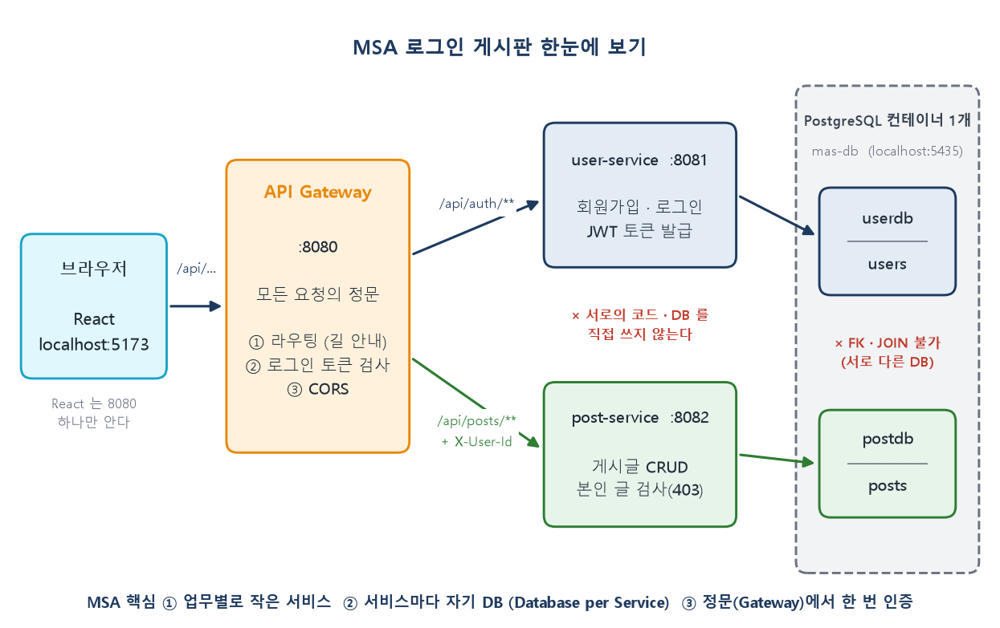
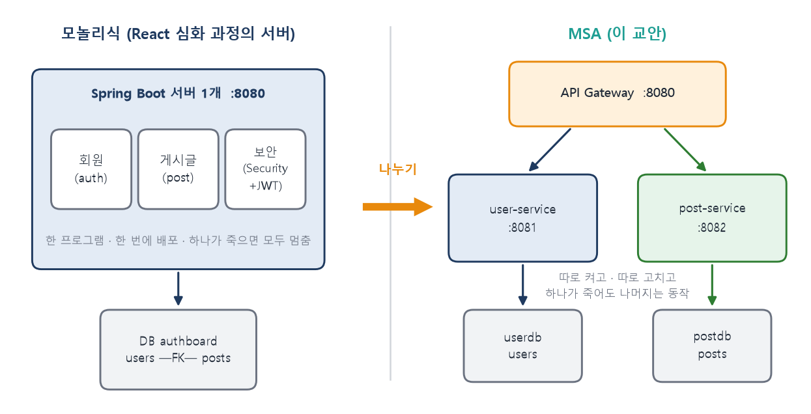
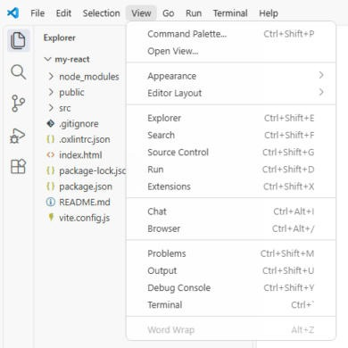
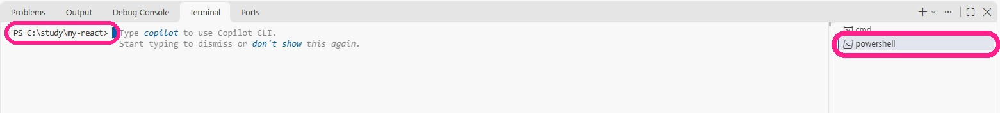
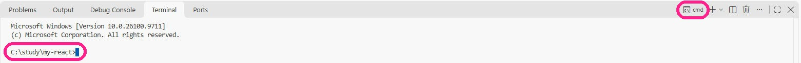
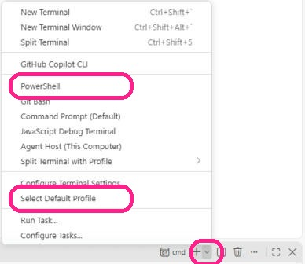

# 0장. 과정 안내

## MSA 한눈에 보기

이 교안에서는 React 심화 과정에서 만든 **로그인 게시판**의 서버를 **MSA(Microservice Architecture, 마이크로서비스 아키텍처)** 로 바꾼다. 먼저 완성된 모습을 그림 한 장으로 보자.



그림을 왼쪽에서 오른쪽으로 따라가 보자.

1. **브라우저(React)** 는 언제나 `http://localhost:8080` 하나로만 요청한다.
2. **API Gateway(8080)** 는 모든 요청이 들어오는 **정문**이다. 주소를 보고 알맞은 서비스로 길을 안내하고(라우팅), 로그인 토큰을 검사한다.
3. **user-service(8081)** 는 회원 일만 한다. 회원가입, 로그인, 토큰 발급을 맡는다.
4. **post-service(8082)** 는 게시글 일만 한다. 글 CRUD와 "본인 글인지" 검사를 맡는다.
5. **PostgreSQL 컨테이너는 하나**지만, 그 안의 **데이터베이스는 서비스마다 따로**다(`userdb`, `postdb`). 서로 다른 DB 라서 외래 키(FK)도 JOIN 도 걸 수 없다.

> **[MSA 개념] 이 교안에서 배우는 세 가지**
>
> ① **업무별로 작은 서비스**: 회원 서비스와 게시글 서비스를 따로 만들고 따로 실행한다.
>
> ② **서비스마다 자기 DB (Database per Service)**: 다른 서비스의 테이블은 직접 읽지 않는다.
>
> ③ **정문에서 한 번 인증**: 토큰 검사는 게이트웨이가 한 번만 하고, 결과(누구인지)를 헤더로 넘긴다.

## 모놀리식에서 MSA 로

React 심화 과정의 서버는 **Spring Boot 프로그램 하나**에 회원·게시글·보안 코드가 모두 들어 있었다. 이런 구조를 **모놀리식(Monolithic, 한 덩어리)** 이라고 부른다. 이 교안에서는 그 한 덩어리를 **세 개의 작은 프로그램**으로 나눈다.



| | 모놀리식 (React 심화 과정) | MSA (이 교안) |
|---|---|---|
| 서버 | Spring Boot 1개 (8080) | 게이트웨이(8080) + user-service(8081) + post-service(8082) |
| DB | `authboard` 1개 (users, posts) | `userdb`(users) + `postdb`(posts), 컨테이너는 1개 (5435) |
| posts 와 users | FK 로 연결, JOIN 으로 닉네임 읽기 | FK 없음. 글을 쓸 때 번호·닉네임을 **복사**해 저장 |
| 로그인 검사 | Spring Security 필터 | 게이트웨이의 `AuthFilter` 한 곳 |
| React 코드 | - | **거의 그대로** (API 주소·JSON 모양이 같음) |

> **React 는 거의 고치지 않는다.** 서버 안쪽을 여러 서비스로 나눠도, React 가 보는 주소(`localhost:8080/api/...`)와 JSON 모양은 그대로 지킨다. 그래서 이 교안은 **서버(Spring Boot) 쪽 이야기**가 대부분이다.

## 진행 순서 (권장 8시간)

| 장 | 내용 | 시간 |
|---|---|---|
| 0장 | 과정 안내, MSA 한눈에 보기 | 0.5 |
| 1장 | MSA 란 무엇인가 - 모놀리식과 비교 | 1 |
| 2장 | DB 준비 - 컨테이너 하나에 DB 둘 | 0.5 |
| 3장 | 프로젝트 구조 - 서비스 3개를 IntelliJ 로 열기 | 0.5 |
| 4장 | user-service - 회원가입 · 로그인 · 토큰 발급 | 1.5 |
| 5장 | post-service - FK 없이 게시글 저장하기 | 1 |
| 6장 | api-gateway - 라우팅과 인증을 정문에서 | 1.5 |
| 7장 | 전체 실행, React 연결, 장애 실험 | 1 |
| 8장 | 정리와 더 나아가기 | 0.5 |

장마다 **개념 → 코드 읽기 → 실행해서 확인 → 확인 문제** 순서다. 확인 문제 풀이는 부록 B 에 있다. 본문 곳곳의 **[MSA 개념]** 상자는 그 코드가 MSA 의 어떤 생각에서 나왔는지 설명한다.

## 0-1. 준비

**필요한 것** - React 심화 과정과 같다.

- Node.js 22 이상, VS Code
- JDK 21 (Eclipse Temurin), **IntelliJ IDEA**
- Docker Desktop, Git

**[PS]** 설치 확인 - 버전이 나오면 된다 (Docker Desktop 은 먼저 실행해 둔다)

```powershell
node -v                   # Node.js 22 이상 (예: v22.x)
npm -v                    # Node.js 와 함께 설치된다
git --version             # Git
docker --version          # Docker Desktop
docker compose version    # compose (Docker Desktop 에 들어 있다)
```

> JDK 21 은 IntelliJ 가 내려받아 쓰므로 `java -version` 이 안 나와도 괜찮다(3장 3-4 의 JDK 설정). 명령이 "인식되지 않습니다" 라고 나오면 그 프로그램을 설치한 뒤 **PowerShell 창을 새로 열고** 다시 확인한다.

**[PS]** 저장소 받기

```powershell
mkdir C:\study -Force      # 실습 폴더 만들기 (이미 있으면 그냥 넘어간다)
cd C:\study
# git clone <주소> : GitHub 저장소를 통째로 내 PC 에 복사한다. 저장소 이름과 같은 폴더가 생기고, 파일·커밋 기록이 모두 들어온다
git clone https://github.com/sinaboro/react-spring-mas-postgresql.git
cd react-spring-mas-postgresql   # 이후 [PS] 명령의 기준 폴더
```

**폴더 구성**

```text
react-spring-mas-postgresql/
├─ docker-compose.yml        PostgreSQL 18 컨테이너 1개 (localhost:5435)
├─ db/init.sql               userdb, postdb 두 데이터베이스 만들기
├─ backend/                  ← IntelliJ 로 이 폴더를 연다
│   ├─ settings.gradle         서비스 3개 묶음
│   ├─ api-gateway/            정문 (8080)   라우팅 + 토큰 검사
│   ├─ user-service/           회원 (8081)   → userdb
│   └─ post-service/           게시글 (8082) → postdb
├─ frontend/                 React (5173) - React 심화 과정 로그인 게시판과 같은 코드
├─ advanced/                 MSA 심화 과정(Kafka) 실습 코드 - 이 기초 교안을 마친 뒤에 쓴다
├─ docs/                     교안 원고와 그림, PDF
└─ tools/                    그림 · PDF 만드는 스크립트
```

> **먼저 해 볼 사람은** 7장의 "7-1. 켜는 순서" 를 따라 전체를 켜 보자. 완성본을 먼저 만져 보고 1장부터 읽으면 이해가 빠르다.

**교안 읽는 법**

- **[PS]** 표시 아래 명령은 PowerShell(또는 VS Code·IntelliJ 의 터미널)에서 친다. 위치가 중요한 명령은 맨 위에 `cd C:\study\...` 가 있으니 그 줄부터 친다.
- 명령 뒤의 `# ...` 는 **설명(주석)** 이다. PowerShell 은 `#` 뒤를 무시하므로 함께 복사해 붙여 넣어도 된다.
- 명령 아래의 회색 상자(`text`)는 **화면에 나오는 결과의 예**다. 번호·시각·토큰은 내 화면과 다를 수 있다.
- 한 상자씩 붙여 넣고, 결과가 교안과 비슷한지 본 뒤 다음으로 넘어간다. 오류가 나면 **부록 A** 에서 증상을 찾는다.
- PowerShell 에서 **마우스 오른쪽 클릭**이 붙여넣기다. 여러 줄을 붙여 넣으면 한 줄씩 차례로 실행된다.

**터미널이 PowerShell 인지 확인하기**

VS Code 에서는 메뉴 **보기(View) → 터미널(Terminal)** (단축키 `` Ctrl+` ``)로 터미널을 연다. (화면은 VS Code 영어판이다)



이 교안의 `function Show-Error`, `Invoke-RestMethod`, `$api = ...` 같은 명령은 **PowerShell 에서만** 동작한다. 프롬프트가 `PS C:\...>` 로 시작하고 오른쪽 목록에 `powershell` 이 보이면 된다.



프롬프트에 `PS` 가 없고 오른쪽에 `cmd` 라고 나오면 **명령 프롬프트(cmd)** 다. 교안을 만든 PC 도 VS Code 기본 터미널이 cmd 로 되어 있었다. cmd 에서는 위 명령이 "내부 또는 외부 명령... 이 아닙니다" 로 실패한다.



그럴 때는 터미널 오른쪽 위 **+** 옆의 **∨** → **PowerShell**. 늘 PowerShell 로 열리게 하려면 같은 목록의 **Select Default Profile**(기본 프로필 선택) → **PowerShell**. (IntelliJ 의 터미널은 처음부터 PowerShell 로 열린다. Windows 시작 메뉴의 **Windows PowerShell** 창을 써도 된다)



## 정리

- 이 교안은 로그인 게시판 서버를 **게이트웨이 + 회원 서비스 + 게시글 서비스**로 나눈다.
- DB 는 컨테이너 하나 안에 **userdb, postdb 두 개**를 두고, 서비스는 자기 DB 만 쓴다.
- React 는 `localhost:8080` 하나만 알면 되므로 거의 그대로 쓴다.
