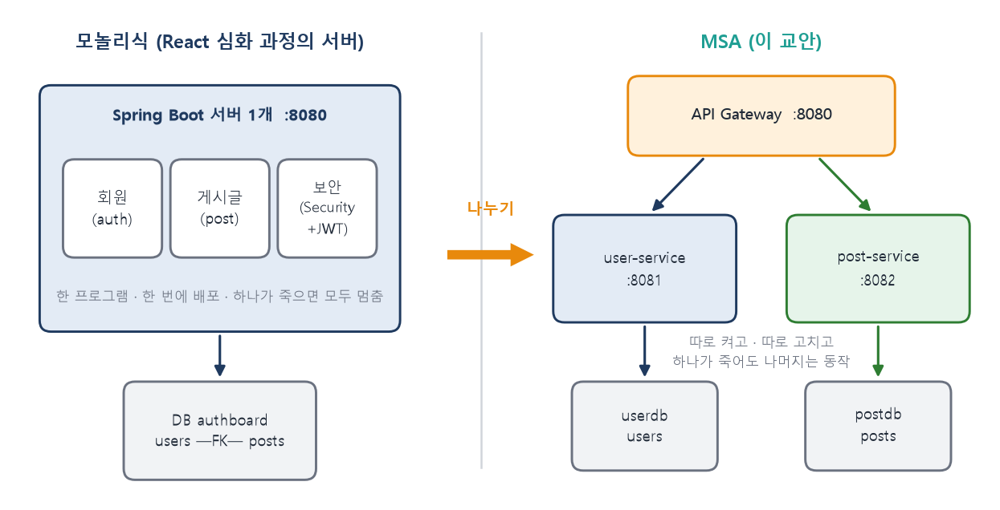
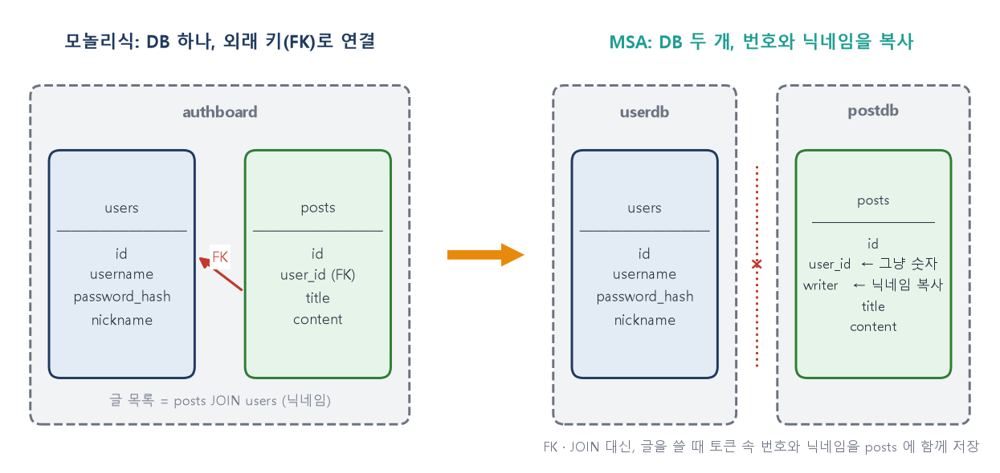

# 1장. MSA 란 무엇인가

## 학습 목표

- 모놀리식과 MSA 의 차이를 내 말로 설명할 수 있다.
- MSA 의 좋은 점과 어려운 점을 하나씩 이상 말할 수 있다.
- 이 교안에서 쓰는 MSA 용어(서비스, 게이트웨이, Database per Service, 데이터 복제)를 안다.

## 1-1. 모놀리식 - 한 덩어리 서버

React 심화 과정의 서버를 떠올려 보자. `backend` 폴더 하나에 이런 패키지가 들어 있었다.

```text
com.example.board
├─ user        회원 Entity, Repository
├─ auth        회원가입 · 로그인 API
├─ post        게시글 API
├─ security    Spring Security + JWT 필터
└─ common      오류 처리
```

이 모든 코드가 **한 프로그램**으로 묶여 한 번에 켜지고, 한 번에 꺼진다. 이것이 **모놀리식**이다. 작은 서비스에서는 모놀리식이 가장 단순하고 좋은 선택이다. 문제는 서비스가 커질 때 생긴다.

| 상황 | 모놀리식에서 생기는 일 |
|---|---|
| 게시글 기능 한 줄을 고쳤다 | 회원 기능까지 포함한 **서버 전체**를 다시 빌드·배포해야 한다 |
| 게시글 쪽에 오류가 나서 서버가 죽었다 | 로그인도, 회원가입도 **모두** 멈춘다 |
| 글 읽기 요청만 엄청 많다 | 글 읽기만 늘릴 수 없고 **서버 전체**를 여러 대 띄워야 한다 |
| 개발자가 50명이다 | 모두 한 저장소, 한 프로그램을 고치므로 서로 부딪친다 |

## 1-2. MSA - 업무별로 나눈 작은 서비스

**MSA(Microservice Architecture)** 는 큰 프로그램을 **업무(도메인)별로 작은 서비스**로 나누는 방법이다. 서비스 하나하나가 **따로 실행되는 프로그램**이고, 서로 **HTTP(REST API)** 로 이야기한다.



> **[MSA 개념] 마이크로서비스의 조건**
> - **한 가지 업무**만 맡는다 (회원, 게시글, 결제, 배송 ...).
> - **따로 실행·배포**할 수 있다 (게시글 서비스만 고쳐서 다시 켜도 된다).
> - **자기 데이터**를 가진다. 다른 서비스의 DB 를 직접 읽지 않는다.
> - 다른 서비스와는 **API(HTTP)** 로만 이야기한다.

## 1-3. 이 교안의 세 서비스

| 서비스 | 포트 | 하는 일 | 쓰는 DB | 핵심 라이브러리 |
|---|---|---|---|---|
| **api-gateway** | 8080 | 라우팅, 토큰 검사, CORS | 없음 | Spring Cloud Gateway, jjwt |
| **user-service** | 8081 | 회원가입, 로그인(토큰 발급), 내 정보 | `userdb` | JPA, BCrypt, jjwt |
| **post-service** | 8082 | 게시글 CRUD, 본인 글 검사 | `postdb` | JPA |

**post-service 에는 Spring Security 도, JWT 라이브러리도 없다.** 토큰 검사는 게이트웨이가 끝내고 "누가 보냈는지" 만 헤더로 알려 주기 때문이다. 서비스가 자기 업무에만 집중하니 코드가 오히려 단순해진다.

## 1-4. MSA 의 핵심 개념 다섯 가지

### ① API Gateway - 정문

서비스가 여러 개면 React 가 "로그인은 8081, 글은 8082" 처럼 모든 주소를 알아야 할까? 그렇지 않다. **게이트웨이**라는 정문을 하나 두고, React 는 정문(8080)으로만 요청한다. 게이트웨이가 주소를 보고 알맞은 서비스로 전달한다. 이것을 **라우팅(routing, 길 안내)** 이라고 한다.

### ② 정문에서 한 번 인증

토큰 검사를 서비스마다 하면 같은 코드가 여러 곳에 생긴다. 그래서 **게이트웨이가 한 번만 검사**하고, 통과한 요청에 `X-User-Id: 3` 같은 헤더를 붙여 서비스로 넘긴다. 서비스는 그 헤더를 믿고 쓴다.

### ③ Database per Service - 서비스마다 자기 DB

회원 서비스는 `userdb` 만, 게시글 서비스는 `postdb` 만 쓴다. 다른 서비스의 테이블을 직접 읽으면, 그 서비스가 테이블을 바꿀 때 내 서비스도 함께 깨진다. 그래서 **DB 를 나눠서 서로 묶이지 않게** 한다.

### ④ 데이터 복제 - FK 대신 복사

DB 가 나뉘면 `posts.user_id → users.id` 외래 키를 걸 수 없고, 글 목록에서 JOIN 으로 닉네임을 가져올 수도 없다. 그래서 글을 쓸 때 **작성자 번호와 닉네임을 posts 테이블에 복사해서** 저장한다.



### ⑤ 장애 격리 - 하나가 죽어도 나머지는 산다

회원 서비스가 꺼져도 게시글 서비스는 살아 있다. 이미 로그인한 사람은 글을 읽고 쓸 수 있다. 7장에서 직접 실험한다.

## 1-5. MSA 가 언제나 좋을까?

아니다. MSA 는 **얻는 것만큼 어려운 점도 많다**.

| 좋은 점 | 어려운 점 |
|---|---|
| 서비스별로 따로 고치고 배포한다 | 켜야 할 프로그램이 많다 (이 교안만 해도 4개 + DB) |
| 한 서비스 장애가 전체로 번지지 않는다 | 서비스 사이 통신이 느리거나 실패할 수 있다 |
| 바쁜 서비스만 골라 늘릴 수 있다 | JOIN 이 안 된다 → 데이터 복제, 동기화 고민 |
| 팀별로 서비스를 나눠 맡는다 | 여러 DB 에 걸친 트랜잭션이 어렵다 |

> **[MSA 개념] 작게 시작하자.** 실제 회사도 처음에는 모놀리식으로 시작하고, 서비스가 커져 위의 문제가 실제로 생길 때 MSA 로 나누는 경우가 많다. 이 교안은 **MSA 의 생각을 배우는 것**이 목표라서, 일부러 작은 게시판을 나눠 본다.

## 정리

- **모놀리식**: 한 프로그램. 단순하지만, 커지면 배포·장애·확장이 한 덩어리로 묶인다.
- **MSA**: 업무별 작은 서비스. 따로 실행하고, 자기 DB 를 가지고, API 로만 이야기한다.
- 이 교안의 서비스: **api-gateway(8080), user-service(8081), post-service(8082)**.
- DB 가 나뉘면 FK·JOIN 대신 **필요한 값을 복사**해 둔다.

## 확인 문제

1. 모놀리식 서버에서 게시글 기능 한 줄을 고치면 무엇을 다시 배포해야 하는가? MSA 에서는?
2. React 가 서비스 주소(8081, 8082)를 몰라도 되는 이유는?
3. post-service 에 Spring Security 와 JWT 라이브러리가 없어도 되는 이유는?
4. Database per Service 를 지키면 `posts` 에서 `users` 로 외래 키를 걸 수 없다. 그럼 글 목록의 작성자 닉네임은 어떻게 보여 줄까?
