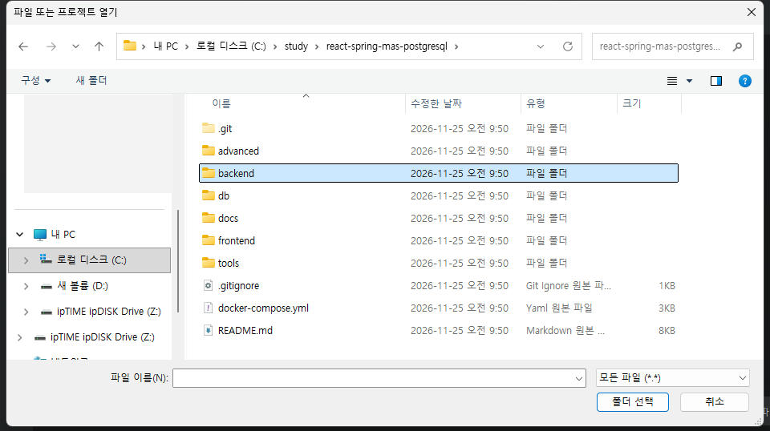
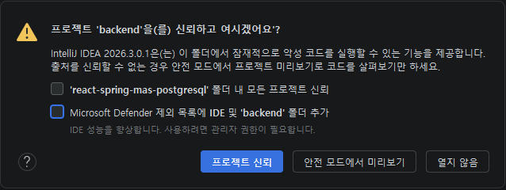
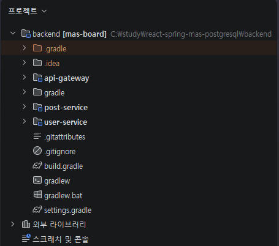
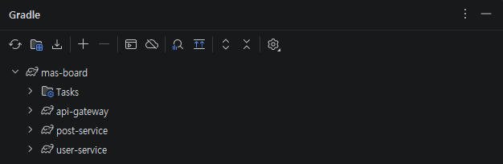
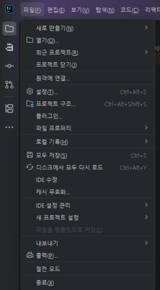
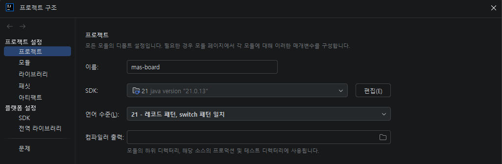
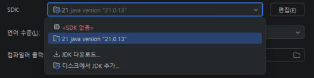
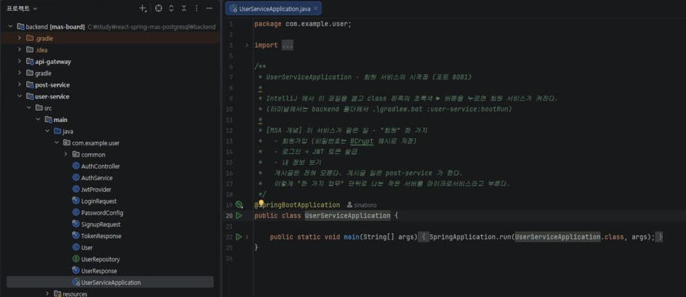
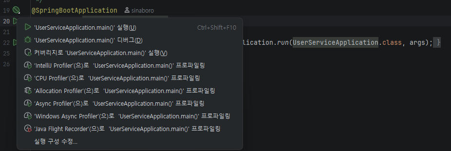
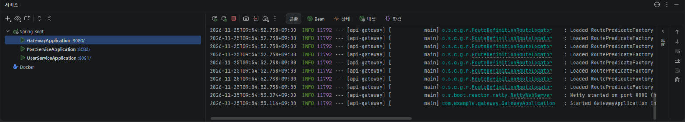

# 3장. 프로젝트 구조 - 서비스 3개를 IntelliJ 로 열기

## 학습 목표

- Gradle **멀티 프로젝트**(한 폴더에 여러 프로그램)의 구조를 안다.
- IntelliJ 에서 `backend` 폴더 하나를 열어 세 서비스를 모두 실행할 수 있다.
- 서비스마다 필요한 라이브러리가 다르다는 것을 `build.gradle` 에서 확인한다.

## 3-1. backend 폴더 둘러보기

```text
backend/
├─ settings.gradle            "이 폴더에는 서비스 3개가 있다"
├─ build.gradle               세 서비스가 함께 쓰는 설정 (Spring Boot 버전, Java 21)
├─ gradlew, gradlew.bat       Gradle 실행기 (Gradle 을 따로 설치하지 않아도 된다)
├─ api-gateway/
│   ├─ build.gradle             게이트웨이에 필요한 라이브러리
│   └─ src/main/...             GatewayApplication, AuthFilter, JwtChecker, GatewayErrorHandler
├─ user-service/
│   ├─ build.gradle
│   └─ src/main/...             UserServiceApplication, User, AuthController, AuthService, JwtProvider ...
└─ post-service/
    ├─ build.gradle
    └─ src/main/...             PostServiceApplication, Post, PostController, PostService ...
```

세 서비스는 **서로의 코드를 import 하지 않는다**. `post-service` 는 `User` 클래스가 있는지도 모른다. 한 폴더에 둔 이유는 IntelliJ 에서 한 번에 열어 보기 편하게 하려는 것뿐이다.

> **[MSA 개념] 코드도 나뉘어 있다.** 실제 회사에서는 서비스마다 **저장소(Git)** 까지 따로 두는 경우가 많다. 그래도 이 교안의 구조와 생각은 같다. 서비스끼리는 코드를 공유하지 않고, **API(HTTP)와 약속한 헤더**로만 이야기한다.

## 3-2. settings.gradle - 서비스 3개 묶기

<!-- file: backend/settings.gradle -->

```groovy
// settings.gradle - 이 폴더(backend)에 들어 있는 서비스 3개를 한 묶음으로 알려 준다
//
// [MSA 개념] 서비스 하나 = 따로 실행되는 Spring Boot 프로그램 하나
//   api-gateway  (8080) : 모든 요청이 들어오는 정문. 로그인 토큰 검사 후 알맞은 서비스로 보낸다
//   user-service (8081) : 회원가입 · 로그인 · 토큰 발급        (DB: userdb)
//   post-service (8082) : 게시글 CRUD                        (DB: postdb)
//
// 세 서비스는 서로의 코드를 import 하지 않는다. 한 폴더에 둔 것은 IntelliJ 에서
// backend 폴더 하나만 열면 세 서비스를 모두 볼 수 있게 하려는 것뿐이다.
// (실제 회사에서는 서비스마다 저장소를 따로 두는 경우가 많다)

rootProject.name = 'mas-board'

include 'api-gateway'
include 'user-service'
include 'post-service'
```

`include` 한 줄이 서비스 하나다. 나중에 댓글 서비스를 만든다면 `comment-service` 폴더(그 안에 `build.gradle` 과 `src`)를 만들고, `include 'comment-service'` 를 한 줄 더 적으면 된다. `include` 만 적고 폴더를 만들지 않으면 서비스가 생기지 않는다.

## 3-3. backend/build.gradle - 함께 쓰는 설정

<!-- file: backend/build.gradle -->

```groovy
// build.gradle (backend 폴더) - 세 서비스가 함께 쓰는 설정
//
// 여기서는 플러그인 "버전"만 정해 둔다 (apply false = 지금 이 폴더에는 적용하지 않음).
// 실제 의존성(라이브러리)은 각 서비스 폴더의 build.gradle 에 따로 적는다.
// → 서비스마다 필요한 라이브러리가 다르다. 게이트웨이는 DB 를 쓰지 않고, post-service 는 JWT 를 모른다.

plugins {
	id 'org.springframework.boot' version '4.1.2' apply false
	id 'io.spring.dependency-management' version '1.1.7' apply false
}

// 세 서비스(subprojects)에 똑같이 들어가는 설정
subprojects {
	apply plugin: 'java'
	apply plugin: 'org.springframework.boot'
	apply plugin: 'io.spring.dependency-management'

	group = 'com.example'
	version = '0.0.1-SNAPSHOT'

	java {
		toolchain {
			languageVersion = JavaLanguageVersion.of(21)
		}
	}

	repositories {
		mavenCentral()
	}

	tasks.named('test') {
		useJUnitPlatform()
	}
}
```

`subprojects { ... }` 안의 내용은 세 서비스에 **똑같이** 들어간다. 그래서 서비스 폴더의 `build.gradle` 에는 **dependencies(라이브러리)만** 적으면 된다. 세 파일을 나란히 놓고 보면 서비스마다 하는 일이 보인다.

| 라이브러리 | api-gateway | user-service | post-service |
|---|---|---|---|
| Spring Cloud Gateway | ✔ | | |
| webmvc (REST API) | | ✔ | ✔ |
| data-jpa + postgresql | | ✔ (userdb) | ✔ (postdb) |
| validation (입력 검사) | | ✔ | ✔ |
| spring-security-crypto (BCrypt) | | ✔ | |
| jjwt (JWT) | ✔ 검사 | ✔ 발급 | |
| springdoc (/docs) | | ✔ | ✔ |

> **post-service 는 가장 가볍다.** 토큰도 비밀번호도 다루지 않는다. 서비스를 나누면 각 서비스는 **자기 일에 필요한 것만** 가진다.

## 3-4. IntelliJ 로 열기 (화면 따라 하기)

화면은 IntelliJ IDEA 2026.3 (한국어, 어두운 테마) 기준이다. 버전에 따라 단추 위치가 조금 다를 수 있지만 순서는 같다. 메뉴가 영어로 보이면 괄호 안의 영어 이름을 찾는다.

**① 프로젝트 열기** - IntelliJ 를 실행하면 첫 화면(Home)이 나온다. 가운데 **파일 열기**(Open) 를 누른다. 이미 다른 프로젝트가 열려 있으면 왼쪽 위 ☰ → **파일(File) → 열기(Open)**.


**② backend 폴더 고르기** - `C:\study\react-spring-mas-postgresql` 로 들어가서 **`backend` 를 한 번 클릭**하고 **폴더 선택**. 저장소 맨 위 폴더(`react-spring-mas-postgresql`)가 아니라 그 안의 `backend` 를 연다. 그래야 IntelliJ 가 Gradle 멀티 프로젝트(서비스 3개)로 알아본다.



**③ 프로젝트 신뢰** - "프로젝트 'backend'을(를) 신뢰하고 여시겠어요?" 가 나오면 **프로젝트 신뢰**(Trust Project). 내가 받은 강사 저장소이므로 믿어도 된다. 아래의 **Microsoft Defender 제외 목록에 추가** 칸은 체크를 **해제**한다. 켜 두면 관리자 권한을 묻고 백신 검사에서 이 폴더를 빼 버린다. (조금 빨라질 뿐, 실습에는 필요 없다)



**④ Gradle 가져오기 기다리기** - 오른쪽 아래에 "'backend' Gradle 프로젝트 가져오는 중" 막대가 돈다. 처음에는 라이브러리를 받느라 **1~5분** 걸린다. 막대가 사라질 때까지 아무것도 누르지 않고 기다린다. 끝나면 왼쪽 **프로젝트** 창에 서비스 폴더 3개가 **굵은 글씨**로 보인다.



**⑤ Gradle 창 확인** - 오른쪽 세로 막대의 **코끼리 아이콘**(Gradle)을 누른다. `mas-board` 아래에 `api-gateway`, `post-service`, `user-service` 가 보이면 성공이다. (`mas-board` 는 `settings.gradle` 의 `rootProject.name`)



> 서비스 3개가 안 보이거나 빨간 오류가 있으면 Gradle 창 맨 왼쪽의 🔄(모든 Gradle 프로젝트 다시 로드)를 누른다. 그래도 안 되면 아래 ⑥ 의 JDK 를 확인한다.

**⑥ JDK 21 확인** - 왼쪽 위 ☰ → **파일(File) → 프로젝트 구조(Project Structure)** (단축키 `Ctrl + Alt + Shift + S`).



**프로젝트** 화면의 **SDK** 가 `21` 이면 그대로 **취소**한다.



SDK 가 `<SDK 없음>` 이거나 17 같은 다른 버전이면, SDK 칸을 눌러 **JDK 다운로드...** → 버전 **21**, 공급업체 **Eclipse Temurin** → 다운로드. 다 받으면 **확인**.



## 3-5. 서비스 실행하는 법

user-service 와 post-service 는 켜지면서 DB 에 접속하므로, **2장의 DB 를 먼저 켜 둔다.** (지금 다 켜 볼 필요는 없다. 4장부터 하나씩 켠다)

| 서비스 | 실행할 파일 | 포트 |
|---|---|---|
| user-service | `user-service/src/main/java/com/example/user/UserServiceApplication.java` | 8081 |
| post-service | `post-service/src/main/java/com/example/post/PostServiceApplication.java` | 8082 |
| api-gateway | `api-gateway/src/main/java/com/example/gateway/GatewayApplication.java` | 8080 |

**① 실행할 파일 열기** - 프로젝트 창에서 `user-service` → `src` → `main` → `java` → `com.example.user` 의 화살표(▸)를 차례로 눌러 펼치고, **UserServiceApplication** 을 **두 번 클릭**한다.



**② ▶ 로 실행** - `public class UserServiceApplication` 줄 왼쪽의 **초록색 ▶** 를 누르고 맨 위의 **'UserServiceApplication.main()' 실행** 을 고른다.



**③ 켜졌는지 확인** - 아래쪽에 **서비스**(Services) 창이 열리고 콘솔에 로그가 올라간다. 마지막 즈음에 `Started UserServiceApplication in ... seconds` 가 보이면 켜진 것이다.

**④ 나머지 두 개는 서비스 창에서** - 한 번 실행하면 IntelliJ 가 같은 프로젝트의 Spring Boot 프로그램을 모두 찾아 **서비스** 창의 **Spring Boot** 아래에 보여 준다. 목록에서 `PostServiceApplication` 을 고르고 위쪽 ▶(실행)를 누르고, `GatewayApplication` 도 같은 방법으로 켠다. 켜진 서비스 옆에는 포트(`:8080/`, `:8081/`, `:8082/`)가 붙는다.



- 끄기: 서비스 창에서 고르고 위쪽 ■(빨간 네모). 다시 켜기: ▶ 또는 ↻.
- 서비스 창이 안 보이면 **보기(View) → 도구 창(Tool Windows) → 서비스(Services)** (`Alt + 8`).
- 오른쪽 위의 **실행 구성** 목록(초록 ▶ 옆)에서 서비스를 골라 켜도 된다.

> 목록에 서비스가 없거나 ▶ 가 회색이면 3-4 의 ④(Gradle 가져오기)가 아직 끝나지 않은 것이다. 오른쪽 아래 진행 막대가 사라질 때까지 기다린다.

**[PS]** IntelliJ 대신 터미널로 켜려면 - `backend` 폴더에서 **터미널 3개**를 열어 하나씩

```powershell
cd C:\study\react-spring-mas-postgresql\backend   # 세 터미널 모두 backend 폴더에서
.\gradlew.bat :user-service:bootRun   # 터미널 1: 회원 서비스 (8081)
.\gradlew.bat :post-service:bootRun   # 터미널 2: 게시글 서비스 (8082)
.\gradlew.bat :api-gateway:bootRun    # 터미널 3: 게이트웨이 (8080)  - 끌 때는 그 터미널에서 Ctrl+C
```

`:서비스이름:bootRun` 은 "그 서비스만 실행" 이라는 뜻이다. 서비스마다 따로 켜지고 따로 꺼진다. **이것이 MSA 다.**

## 정리

- `backend` 는 Gradle 멀티 프로젝트다. `settings.gradle` 의 `include` 하나가 서비스 하나다.
- 공통 설정은 `backend/build.gradle`, 서비스별 라이브러리는 각 서비스의 `build.gradle` 에 둔다.
- IntelliJ 에서 `backend` 를 열고, 서비스마다 `...Application` 의 ▶ 로 따로 켠다.

## 확인 문제

1. `post-service` 의 `build.gradle` 에 jjwt 가 없는 이유는?
2. 터미널에서 게시글 서비스만 켜는 명령은?
3. 새 서비스 `comment-service` 를 추가하려면 `settings.gradle` 에 무엇을 적어야 하는가?
