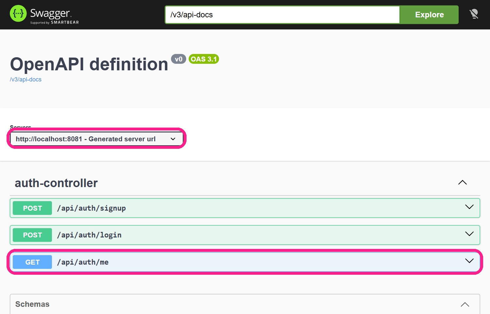

# 4장. user-service - 회원가입 · 로그인 · 토큰 발급

## 학습 목표

- 회원 서비스가 **자기 DB(userdb)** 만 쓰도록 설정한다.
- 로그인에 성공하면 **닉네임까지 담은 JWT** 를 발급한다.
- 로그인 검사(Spring Security)를 서비스에서 빼고, 게이트웨이가 준 **X-User-Id 헤더**로 "내 정보" 를 돌려준다.

## 4-1. 모놀리식 판과 무엇이 다른가

| | 모놀리식 (React 심화 과정) | user-service |
|---|---|---|
| 맡은 일 | 회원 + 게시글 + 보안 | **회원만** |
| DB | `authboard` | **`userdb`** |
| 비밀번호 해시 | Spring Security 전체 | **spring-security-crypto** (BCrypt 도구만) |
| 토큰 | 발급 + 검사 | **발급만** (검사는 게이트웨이) |
| 토큰 내용 | `sub`(번호) | `sub`(번호) + **`nickname`** |
| "지금 요청한 사람" | `@AuthenticationPrincipal LoginUser` | **`@RequestHeader("X-User-Id")`** |
| 파일 | SecurityConfig, JwtAuthenticationFilter, LoginUser ... | **없음** (그만큼 단순해졌다) |

API 주소와 JSON 은 모놀리식 판과 **똑같다**.

| 주소 | 방식 | 로그인 | 하는 일 | 성공 |
|---|---|---|---|---|
| `/api/auth/signup` | POST | - | 회원가입 | 201 |
| `/api/auth/login` | POST | - | 로그인 → 토큰 발급 | 200 |
| `/api/auth/me` | GET | 필요 | 토큰 주인 정보 | 200 |

```text
user-service/src/main/java/com/example/user
├─ UserServiceApplication.java    시작점 (8081)
├─ User.java, UserRepository.java  users 테이블
├─ AuthController.java             API 3개
├─ AuthService.java                가입 · 로그인 · 내 정보 규칙
├─ JwtProvider.java                토큰 만들기
├─ PasswordConfig.java             BCrypt 도구 등록
├─ SignupRequest, LoginRequest, UserResponse, TokenResponse   요청·응답 JSON (React 심화 과정과 같음)
└─ common/ApiException, GlobalExceptionHandler                  오류 → {"detail": ...}
```

## 4-2. 설정 - userdb 에만 접속

<!-- file: backend/user-service/src/main/resources/application.yml -->

```yaml
# application.yml - 회원 서비스(user-service) 설정
#   ${이름:기본값} → 환경 변수 "이름" 이 있으면 그 값, 없으면 기본값

server:
  port: 8081                     # 게이트웨이(8080)가 /api/auth/** 요청을 이 포트로 보내 준다

spring:
  servlet:
    encoding:
      force-response: true       # 응답에 "charset=UTF-8" 을 붙인다 → Windows PowerShell 5.1 에서도 한글이 깨지지 않는다
  application:
    name: user-service
  datasource:
    # [MSA 개념] 회원 서비스는 userdb 에만 접속한다. postdb(게시글)는 모른다.
    url: ${DB_URL:jdbc:postgresql://localhost:5435/userdb}
    username: postgres
    password: postgres
  jpa:
    hibernate:
      ddl-auto: update           # User Entity 를 보고 users 테이블을 만든다
    show-sql: true
    open-in-view: false

# JWT(로그인 토큰) 설정 - JwtProvider 가 읽어 간다
jwt:
  # 토큰 서명 열쇠. api-gateway 의 jwt.secret 과 "반드시 같은 값" 이어야 한다.
  #   user-service 가 이 열쇠로 서명 → api-gateway 가 같은 열쇠로 진짜인지 확인
  # 실제 서비스에서는 환경 변수 JWT_SECRET 으로 넣고 GitHub 에 올리지 않는다. (32글자 이상)
  secret: ${JWT_SECRET:dev-only-secret-change-me-0123456789abcdef}
  expiration-minutes: ${ACCESS_TOKEN_MINUTES:60}    # 토큰 유효 시간(분)

springdoc:
  swagger-ui:
    path: /docs                  # http://localhost:8081/docs
```

> **[MSA 개념] 접속 주소가 곧 경계선이다.** user-service 의 `datasource.url` 에는 `userdb` 만 적혀 있다. 이 서비스는 `postdb` 의 존재조차 모른다. 다른 서비스의 데이터가 필요하면 **DB 가 아니라 API** 로 물어봐야 한다.

`spring.servlet.encoding.force-response` 는 응답에 `charset=UTF-8` 을 붙여 PowerShell 에서도 한글이 깨지지 않게 하는 설정이다(7장 참고). MSA 와는 관계없다.

`jwt.secret` 은 **게이트웨이와 반드시 같은 값**이어야 한다. user-service 가 이 열쇠로 서명한 토큰을, 게이트웨이가 같은 열쇠로 검사하기 때문이다. (6장)

## 4-3. 라이브러리 - Security 전체 대신 crypto 만

<!-- file: backend/user-service/build.gradle -->

```groovy
// build.gradle (user-service) - 회원 서비스에 필요한 라이브러리
//
//   webmvc               : REST API 만들기 (@RestController)
//   data-jpa + postgresql : userdb 의 users 테이블 쓰기
//   validation           : 가입 입력 검사 (@NotBlank, @Pattern ...)
//   spring-security-crypto : BCrypt 비밀번호 해시 "도구만" 쓴다.
//                          Spring Security 전체(로그인 필터, 주소 규칙)는 쓰지 않는다.
//                          → 로그인 검사는 api-gateway 가 맡기 때문이다 (MSA 개념: 인증은 정문에서 한 번)
//   jjwt                 : 로그인에 성공하면 JWT 토큰을 "만든다" (검사는 게이트웨이가 한다)
//   springdoc            : http://localhost:8081/docs 에서 API 를 바로 시험해 보기

dependencies {
	implementation 'org.springframework.boot:spring-boot-starter-webmvc'
	implementation 'org.springframework.boot:spring-boot-starter-data-jpa'
	implementation 'org.springframework.boot:spring-boot-starter-validation'
	implementation 'org.springframework.security:spring-security-crypto'
	implementation 'org.springdoc:springdoc-openapi-starter-webmvc-ui:3.2.0'
	implementation 'io.jsonwebtoken:jjwt-api:0.13.0'
	runtimeOnly 'io.jsonwebtoken:jjwt-impl:0.13.0'
	runtimeOnly 'io.jsonwebtoken:jjwt-jackson:0.13.0'
	runtimeOnly 'org.postgresql:postgresql'
}
```

React 심화 과정에서는 `spring-boot-starter-security` 를 넣었다. 그러면 Spring Security 가 **모든 요청을 막고** 로그인 화면·필터·주소 규칙을 함께 켠다. 이번에는 로그인 검사를 게이트웨이가 하므로, BCrypt 해시 도구가 든 `spring-security-crypto` 만 넣는다. 도구만 쓰니 Bean 하나만 등록하면 된다.

<!-- file: backend/user-service/src/main/java/com/example/user/PasswordConfig.java -->

```java
package com.example.user;

import org.springframework.context.annotation.Bean;
import org.springframework.context.annotation.Configuration;
import org.springframework.security.crypto.bcrypt.BCryptPasswordEncoder;
import org.springframework.security.crypto.password.PasswordEncoder;

/**
 * PasswordConfig - 비밀번호 해시 도구(BCrypt)를 Bean 으로 등록
 *
 *   encode("password123")        → "$2a$10$Q5..." (매번 다른 값. 소금(salt)을 섞기 때문)
 *   matches("password123", 해시)  → true / false
 *
 * 모놀리식 판에서는 SecurityConfig 안에 있었다. 이 서비스는 Spring Security 전체를 쓰지 않고
 * 해시 도구(spring-security-crypto)만 쓰므로, 이 작은 설정 파일 하나면 된다.
 */
@Configuration
public class PasswordConfig {

	@Bean
	public PasswordEncoder passwordEncoder() {
		return new BCryptPasswordEncoder();
	}
}
```

## 4-4. User Entity - 바뀐 것 없음

<!-- file: backend/user-service/src/main/java/com/example/user/User.java -->

```java
package com.example.user;

import jakarta.persistence.Column;
import jakarta.persistence.Entity;
import jakarta.persistence.GeneratedValue;
import jakarta.persistence.GenerationType;
import jakarta.persistence.Id;
import jakarta.persistence.PrePersist;
import jakarta.persistence.Table;
import java.time.LocalDateTime;
import java.time.temporal.ChronoUnit;

/**
 * User - 회원 Entity (userdb 의 users 테이블)
 *
 *   id             bigint        자동 번호
 *   username       varchar(30)   로그인 아이디 (UNIQUE: 중복 불가)
 *   password_hash  varchar(255)  비밀번호가 아니라 "해시" 를 저장한다 (BCrypt)
 *   nickname       varchar(30)   화면에 보일 이름
 *   created_at     timestamp     가입 시각
 *
 * 모놀리식(한 서버) 판과 달라진 점이 없다. 회원 정보는 회원 서비스가 혼자 책임진다.
 * 테이블 이름을 user 가 아니라 users 로 정한 이유: PostgreSQL 에서 user 는 예약어라서.
 */
@Entity
@Table(name = "users")
public class User {

	@Id
	@GeneratedValue(strategy = GenerationType.IDENTITY)
	private Long id;

	@Column(nullable = false, unique = true, length = 30)
	private String username;

	@Column(nullable = false)
	private String passwordHash;

	@Column(nullable = false, length = 30)
	private String nickname;

	@Column(nullable = false, updatable = false)
	private LocalDateTime createdAt;

	protected User() { // JPA 가 DB 에서 읽어 올 때 쓰는 빈 생성자
	}

	public User(String username, String passwordHash, String nickname) {
		this.username = username;
		this.passwordHash = passwordHash;
		this.nickname = nickname;
	}

	@PrePersist // INSERT 직전에 자동 실행
	void onCreate() {
		createdAt = LocalDateTime.now().truncatedTo(ChronoUnit.MICROS); // PostgreSQL 저장 단위(마이크로초)에 맞춘다
	}

	public Long getId() { return id; }
	public String getUsername() { return username; }
	public String getPasswordHash() { return passwordHash; }
	public String getNickname() { return nickname; }
	public LocalDateTime getCreatedAt() { return createdAt; }
}
```

회원 테이블은 React 심화 과정과 같다. 다른 점은 **어느 DB 에 만들어지는가**(userdb) 하나뿐이다.

## 4-5. JwtProvider - 토큰에 닉네임 싣기

<!-- file: backend/user-service/src/main/java/com/example/user/JwtProvider.java -->

```java
package com.example.user;

import io.jsonwebtoken.Jwts;
import io.jsonwebtoken.security.Keys;
import java.nio.charset.StandardCharsets;
import java.time.Duration;
import java.time.Instant;
import java.util.Date;
import javax.crypto.SecretKey;
import org.springframework.beans.factory.annotation.Value;
import org.springframework.stereotype.Component;

/**
 * JwtProvider - JWT(로그인 토큰) "만들기" 전용
 *
 * [MSA 개념] 토큰은 회원 서비스가 만들고, 검사는 게이트웨이가 한다
 *   - 회원 서비스 : 로그인에 성공하면 비밀 열쇠로 서명한 토큰을 발급한다 (이 파일)
 *   - 게이트웨이  : 요청마다 같은 비밀 열쇠로 토큰이 진짜인지 확인한다 (api-gateway 의 JwtChecker)
 *   두 서비스가 같은 열쇠(jwt.secret)를 나눠 가지므로, 게이트웨이는 회원 서비스나 userdb 에
 *   물어보지 않고도 "누가 보낸 요청인지" 알 수 있다.
 *
 * 토큰 안에 넣는 것 (토큰 내용은 누구나 읽을 수 있으므로 비밀번호는 절대 넣지 않는다)
 *   sub      : 사용자 번호 (예: "3")
 *   nickname : 닉네임 (예: "민수") ← 모놀리식 판에는 없던 것.
 *              게시글 서비스가 글쓴이 이름을 알아야 하는데 userdb 를 볼 수 없으니 토큰에 실어 보낸다.
 *   iat, exp : 발급 시각, 만료 시각
 */
@Component
public class JwtProvider {

	private final SecretKey key;
	private final Duration expiration;

	public JwtProvider(@Value("${jwt.secret}") String secret,
			@Value("${jwt.expiration-minutes}") long expirationMinutes) {
		// HS256 은 32바이트(256비트) 이상의 열쇠가 필요하다. 짧으면 서버가 켜질 때 오류가 난다
		this.key = Keys.hmacShaKeyFor(secret.getBytes(StandardCharsets.UTF_8));
		this.expiration = Duration.ofMinutes(expirationMinutes);
	}

	/** 회원 정보를 담은 토큰을 만든다 */
	public String createToken(User user) {
		Instant now = Instant.now();
		return Jwts.builder()
				.subject(String.valueOf(user.getId())) //        sub: 토큰 주인 번호 (문자열로 넣는 것이 규칙)
				.claim("nickname", user.getNickname()) //        nickname: 글쓴이 이름으로 쓰인다
				.issuedAt(Date.from(now)) //                     iat: 발급 시각
				.expiration(Date.from(now.plus(expiration))) //  exp: 만료 시각
				.signWith(key) //                                서명 (열쇠 길이를 보고 HS256 을 고른다)
				.compact(); //                                   "헤더.내용.서명" 글자로
	}
}
```

React 심화 과정 토큰에는 사용자 번호(`sub`)만 있었다. 이번에는 `.claim("nickname", ...)` 으로 **닉네임**을 더 넣는다. 로그인한 minsu(민수)의 토큰 가운데 부분(내용)을 풀어 보면 이렇다.

```json
{ "sub": "1", "nickname": "민수", "iat": 1795493407, "exp": 1795497007 }
```

> **[MSA 개념] 왜 닉네임을 토큰에 넣을까?**
>
> post-service 는 글쓴이 닉네임을 `posts.writer` 에 저장해야 한다(5장). 그런데 post-service 는 `userdb` 를 볼 수 없다. user-service 에 "1번 회원 닉네임이 뭐예요?" 하고 API 로 물어볼 수도 있지만, 그러면 글을 쓸 때마다 서비스끼리 통신해야 하고, user-service 가 꺼지면 글도 못 쓴다. **토큰에 실어 보내면** 게이트웨이가 토큰을 검사할 때 닉네임을 함께 꺼내 전달할 수 있다.
>
> 대신 토큰 내용은 누구나 읽을 수 있으므로 **비밀번호 같은 비밀은 절대 넣지 않는다.**

## 4-6. AuthService - 가입 · 로그인 · 내 정보

<!-- file: backend/user-service/src/main/java/com/example/user/AuthService.java -->

```java
package com.example.user;

import com.example.user.common.ApiException;
import org.springframework.http.HttpStatus;
import org.springframework.security.crypto.password.PasswordEncoder;
import org.springframework.stereotype.Service;
import org.springframework.transaction.annotation.Transactional;

/**
 * AuthService - 회원가입·로그인·내 정보 규칙
 *
 *   가입   : 아이디 중복이면 409 → 비밀번호를 BCrypt 해시로 바꿔 저장
 *   로그인 : 아이디로 회원 찾기 → 비밀번호와 해시 비교 → 맞으면 JWT 발급
 *   내 정보 : 게이트웨이가 알려 준 사용자 번호로 회원을 찾아 돌려준다
 */
@Service
@Transactional(readOnly = true)
public class AuthService {

	private final UserRepository userRepository;
	private final PasswordEncoder passwordEncoder;
	private final JwtProvider jwtProvider;

	public AuthService(UserRepository userRepository, PasswordEncoder passwordEncoder, JwtProvider jwtProvider) {
		this.userRepository = userRepository;
		this.passwordEncoder = passwordEncoder;
		this.jwtProvider = jwtProvider;
	}

	@Transactional
	public UserResponse signup(SignupRequest request) {
		if (userRepository.existsByUsername(request.username())) {
			throw new ApiException(HttpStatus.CONFLICT, "이미 사용 중인 아이디입니다"); // 409
		}
		String hash = passwordEncoder.encode(request.password()); // 비밀번호 → 해시
		User user = userRepository.save(new User(request.username(), hash, request.nickname().strip()));
		return UserResponse.from(user);
	}

	public TokenResponse login(LoginRequest request) {
		User user = userRepository.findByUsername(request.username())
				// 아이디가 없을 때와 비밀번호가 틀릴 때 같은 메시지를 준다
				// → "이 아이디는 가입되어 있다" 는 정보를 공격자에게 주지 않기 위해
				.filter(u -> passwordEncoder.matches(request.password(), u.getPasswordHash()))
				.orElseThrow(() -> new ApiException(HttpStatus.UNAUTHORIZED, "아이디 또는 비밀번호가 올바르지 않습니다"));
		String token = jwtProvider.createToken(user); // 번호 + 닉네임을 담은 토큰
		return TokenResponse.bearer(token, UserResponse.from(user));
	}

	public UserResponse me(Long userId) {
		return userRepository.findById(userId)
				.map(UserResponse::from)
				// 토큰은 진짜인데 회원이 없다 = 토큰 발급 뒤에 DB 를 지웠다 → 다시 로그인하게 한다
				.orElseThrow(() -> new ApiException(HttpStatus.UNAUTHORIZED, "로그인이 만료되었습니다. 다시 로그인하세요"));
	}
}
```

React 심화 과정과 거의 같다. 달라진 곳은 `jwtProvider.createToken(user)` 로 **User 전체**를 넘겨 닉네임까지 담는 것뿐이다.

## 4-7. AuthController - X-User-Id 헤더로 "나" 를 안다

<!-- file: backend/user-service/src/main/java/com/example/user/AuthController.java -->

```java
package com.example.user;

import jakarta.validation.Valid;
import org.springframework.http.HttpStatus;
import org.springframework.web.bind.annotation.GetMapping;
import org.springframework.web.bind.annotation.PostMapping;
import org.springframework.web.bind.annotation.RequestBody;
import org.springframework.web.bind.annotation.RequestHeader;
import org.springframework.web.bind.annotation.RequestMapping;
import org.springframework.web.bind.annotation.ResponseStatus;
import org.springframework.web.bind.annotation.RestController;

/**
 * AuthController - 회원가입·로그인·내 정보 API (회원 서비스, 포트 8081)
 *
 *   주소                 방식   로그인   하는 일                 성공
 *   /api/auth/signup     POST   -        회원가입                 201
 *   /api/auth/login      POST   -        로그인 → 토큰 발급        200
 *   /api/auth/me         GET    필요     토큰 주인의 정보          200
 *
 * [MSA 개념] "로그인 필요" 검사는 이 서비스가 하지 않는다
 *   React 는 항상 게이트웨이(8080)로 요청한다. 게이트웨이가 토큰을 검사하고,
 *   통과하면 요청 헤더에 "X-User-Id: 3" 을 붙여서 이 서비스로 넘겨 준다.
 *   그래서 이 서비스는 토큰을 볼 필요 없이 @RequestHeader("X-User-Id") 로 번호만 꺼내 쓰면 된다.
 *   (X-User-Id 헤더 없이 8081 로 직접 부르면 GlobalExceptionHandler 가 401 로 응답한다)
 */
@RestController
@RequestMapping("/api/auth")
public class AuthController {

	private final AuthService authService;

	public AuthController(AuthService authService) {
		this.authService = authService;
	}

	@PostMapping("/signup")
	@ResponseStatus(HttpStatus.CREATED)
	public UserResponse signup(@Valid @RequestBody SignupRequest request) {
		return authService.signup(request);
	}

	@PostMapping("/login")
	public TokenResponse login(@Valid @RequestBody LoginRequest request) {
		return authService.login(request);
	}

	@GetMapping("/me")
	public UserResponse me(@RequestHeader("X-User-Id") Long userId) { // 게이트웨이가 붙여 준 사용자 번호
		return authService.me(userId);
	}
}
```

`/me` 를 보자. React 심화 과정에서는 Spring Security 가 토큰을 검사해 `@AuthenticationPrincipal LoginUser` 로 넣어 줬다. 이제는 **게이트웨이가** 토큰을 검사하고 `X-User-Id: 1` 헤더를 붙여 보낸다. 서비스는 `@RequestHeader("X-User-Id") Long userId` 로 그 값만 받으면 된다.

헤더가 없을 때(게이트웨이를 거치지 않았을 때)는 `GlobalExceptionHandler` 에 더한 아래 코드가 401 로 응답한다.

```java
@ExceptionHandler(MissingRequestHeaderException.class)
public ResponseEntity<Map<String, String>> handleMissingHeader(MissingRequestHeaderException e) {
    return detail(HttpStatus.UNAUTHORIZED, "로그인이 필요합니다");
}
```

## 4-8. 켜서 시험하기

2장의 DB 가 켜져 있는지 확인하고, IntelliJ 에서 `UserServiceApplication` 을 ▶ 로 실행한다. 콘솔 끝에 아래 줄이 보이면 성공이다.

```text
Started UserServiceApplication in 12.965 seconds
```

**① /docs 로 시험** - 브라우저에서 http://localhost:8081/docs 를 연다. 회원 서비스의 API 3개만 보인다. 게시글 API 는 이 서비스에 없기 때문이다.



**POST /api/auth/signup → Try it out** 에 아래 JSON 을 넣고 **Execute** → 201 이 나오면 가입 성공이다.

```json
{ "username": "minsu", "password": "password123", "nickname": "민수" }
```

**② userdb 에 저장됐는지 확인**

**[PS]**

```powershell
docker exec mas-db psql -U postgres -d userdb -c "select id, username, nickname from users"
docker exec mas-db psql -U postgres -d postdb -c "\dt"
```

```text
 id | username | nickname
----+----------+----------
  1 | minsu    | 민수

Did not find any relations.        ← postdb 에는 아직 아무 테이블도 없다
```

`users` 는 `userdb` 에만 생겼다. post-service 를 켜지 않았으니 `postdb` 는 비어 있다. (0장 끝에서 전체를 먼저 켜 봤다면 `postdb` 에 `posts` 가 이미 있다. 그래도 `users` 는 `postdb` 에 없다는 점은 같다)

> **이 minsu 계정은 7장에서도 그대로 쓴다.** 7장에서 React 로 회원가입할 때 minsu 가 이미 있다고 나오면(409 `이미 사용 중인 아이디입니다`) 가입하지 말고 바로 로그인하면 된다.

**③ /me 를 직접 불러 보기** - `/docs` 에서 `GET /api/auth/me` 를 열면 `X-User-Id` 입력 칸이 보인다. `1` 을 넣고 Execute 하면 민수의 정보가 나온다. (이 칸은 필수라서 비워 두면 Swagger 화면이 요청을 보내지 않고 빨간 테두리만 보여 준다)

헤더 **없이** 보내면 어떻게 될까? PowerShell 로 직접 보내 보자. 먼저 오류 응답을 보기 좋게 찍어 주는 작은 함수를 만든다. (Windows PowerShell 5.1 은 오류 응답의 내용을 보여 주지 않을 때가 있어서 이 함수가 필요하다. 7장에서도 쓴다)

**[PS]**

```powershell
# 오류가 나면 "상태코드 {"detail": "..."}" 모양으로 보여 주는 함수
function Show-Error($err) {
  if ($err.ErrorDetails.Message) { $body = $err.ErrorDetails.Message }
  else {
    $reader = New-Object System.IO.StreamReader($err.Exception.Response.GetResponseStream(), [System.Text.Encoding]::UTF8)
    $body = $reader.ReadToEnd()
  }
  "$([int]$err.Exception.Response.StatusCode) $body"
}
try { Invoke-RestMethod http://localhost:8081/api/auth/me } catch { Show-Error $_ }
Invoke-RestMethod http://localhost:8081/api/auth/me -Headers @{ "X-User-Id" = "1" }
```

```text
401 {"detail":"로그인이 필요합니다"}

id username nickname
-- -------- --------
 1 minsu    민수
```

> **[MSA 개념] 서비스 포트는 바깥에 열지 않는다.**
>
> 방금 `X-User-Id` 에 아무 번호나 넣으니 그 사람 정보가 나왔다. 서비스는 "이 헤더는 게이트웨이가 검사하고 붙였다" 고 **믿기** 때문이다. 그래서 실제 운영에서는 **게이트웨이(8080)만 인터넷에 열고**, 서비스 포트(8081, 8082)는 내부망에서만 보이게 막는다. 이 교안은 공부를 위해 `/docs` 로 직접 불러 볼 수 있게 열어 둔 것이다.

## 정리

- user-service 는 **회원 일만** 하고 **userdb 만** 쓴다.
- BCrypt 는 `spring-security-crypto` 도구만 쓰고, 로그인 검사는 게이트웨이에 맡긴다.
- 토큰에 **nickname** 을 더 실어서, 다른 서비스가 userdb 없이도 닉네임을 알 수 있게 한다.
- "지금 요청한 사람" 은 게이트웨이가 붙인 **X-User-Id 헤더**로 안다.

## 확인 문제

1. user-service 가 `spring-boot-starter-security` 대신 `spring-security-crypto` 만 쓰는 이유는?
2. 토큰에 비밀번호 해시를 넣으면 안 되는 이유는?
3. `GET /api/auth/me` 를 8081 로 직접 부르면서 `X-User-Id` 헤더를 빼면 어떤 응답이 오는가? 어느 코드가 그 응답을 만드는가?
