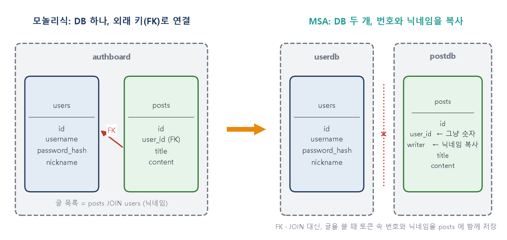

# 5장. post-service - FK 없이 게시글 저장하기

## 학습 목표

- `@ManyToOne User author` 대신 **`Long userId` + `String writer`** 로 작성자를 저장한다.
- 다른 DB 의 데이터가 필요할 때 **복사해 두는 방법(데이터 복제)** 과 그 대가를 안다.
- 게이트웨이가 붙여 준 헤더(`X-User-Id`, `X-User-Nickname`)로 작성자와 소유권을 판단한다.

## 5-1. 모놀리식 판과 무엇이 다른가

| | 모놀리식 (심화 과정) | post-service |
|---|---|---|
| DB | `authboard` (users 와 같은 DB) | **`postdb`** (users 는 다른 DB) |
| 작성자 | `@ManyToOne User author` (FK) | **`Long userId`** + **`String writer`** |
| 닉네임 읽기 | JOIN (`@EntityGraph`) | posts 테이블 안의 `writer` 그대로 |
| 필요한 Repository | PostRepository + **UserRepository** | **PostRepository 만** |
| 로그인한 사람 | `@AuthenticationPrincipal LoginUser` | **`@RequestHeader("X-User-Id")`** |
| 보안 라이브러리 | Spring Security, jjwt | **없음** |

API 주소와 JSON 은 모놀리식 판과 같다.

| 주소 | 방식 | 로그인 | 하는 일 |
|---|---|---|---|
| `/api/posts` | GET | - | 목록 (`?user_id=3` 이면 그 사람 글만) |
| `/api/posts/{id}` | GET | - | 글 하나 |
| `/api/posts` | POST | 필요 | 새 글 (작성자 = 토큰 주인) |
| `/api/posts/{id}` | PUT | 본인 | 수정 |
| `/api/posts/{id}` | DELETE | 본인 | 삭제 (204) |

## 5-2. 설정과 라이브러리

<!-- file: backend/post-service/src/main/resources/application.yml -->

```yaml
# application.yml - 게시글 서비스(post-service) 설정
#   ${이름:기본값} → 환경 변수 "이름" 이 있으면 그 값, 없으면 기본값

server:
  port: 8082                     # 게이트웨이(8080)가 /api/posts/** 요청을 이 포트로 보내 준다

spring:
  servlet:
    encoding:
      force-response: true       # 응답에 "charset=UTF-8" 을 붙인다 → Windows PowerShell 5.1 에서도 한글이 깨지지 않는다
  application:
    name: post-service
  datasource:
    # [MSA 개념] 게시글 서비스는 postdb 에만 접속한다. userdb(회원)는 모른다.
    #   그래서 posts.user_id 에서 users 로 외래 키(FK)를 걸 수 없고, JOIN 도 할 수 없다.
    url: ${DB_URL:jdbc:postgresql://localhost:5435/postdb}
    username: postgres
    password: postgres
  jpa:
    hibernate:
      ddl-auto: update           # Post Entity 를 보고 posts 테이블을 만든다
    show-sql: true
    open-in-view: false

# JWT 설정이 없다 - 게시글 서비스는 토큰을 다루지 않는다 (게이트웨이가 검사한다)

springdoc:
  swagger-ui:
    path: /docs                  # http://localhost:8082/docs
```

<!-- file: backend/post-service/build.gradle -->

```groovy
// build.gradle (post-service) - 게시글 서비스에 필요한 라이브러리
//
//   webmvc               : REST API 만들기
//   data-jpa + postgresql : postdb 의 posts 테이블 쓰기
//   validation           : 글 입력 검사 (@NotBlank, @Size)
//   springdoc            : http://localhost:8082/docs
//
// 눈여겨볼 점: Spring Security 도, JWT(jjwt) 도 없다!
//   [MSA 개념] 토큰 검사는 게이트웨이가 끝내고 "X-User-Id" 헤더로 결과만 알려 준다.
//   그래서 게시글 서비스는 게시글 일에만 집중하는 아주 단순한 서버가 된다.

dependencies {
	implementation 'org.springframework.boot:spring-boot-starter-webmvc'
	implementation 'org.springframework.boot:spring-boot-starter-data-jpa'
	implementation 'org.springframework.boot:spring-boot-starter-validation'
	implementation 'org.springdoc:springdoc-openapi-starter-webmvc-ui:3.2.0'
	runtimeOnly 'org.postgresql:postgresql'
}
```

`jwt` 설정도, jjwt 라이브러리도 없다. **post-service 는 토큰이 무엇인지 모른다.**

## 5-3. Post Entity - FK 대신 번호와 닉네임 복사



<!-- file: backend/post-service/src/main/java/com/example/post/Post.java -->

```java
package com.example.post;

import jakarta.persistence.Column;
import jakarta.persistence.Entity;
import jakarta.persistence.GeneratedValue;
import jakarta.persistence.GenerationType;
import jakarta.persistence.Id;
import jakarta.persistence.PrePersist;
import jakarta.persistence.PreUpdate;
import jakarta.persistence.Table;
import java.time.LocalDateTime;
import java.time.temporal.ChronoUnit;

/**
 * Post - 게시글 Entity (postdb 의 posts 테이블)
 *
 *   id          bigint        자동 번호
 *   user_id     bigint        글쓴이 회원 번호   ← 외래 키(FK)가 아닌 "그냥 숫자"
 *   writer      varchar(30)   글쓴이 닉네임      ← 글을 쓸 때 복사해 둔 값
 *   title       varchar(100)  제목
 *   content     text          내용
 *   created_at  timestamp     쓴 시각
 *   updated_at  timestamp     고친 시각
 *
 * [MSA 개념] 모놀리식 판과 가장 크게 달라진 곳
 *   모놀리식 : @ManyToOne User author  → posts.user_id 가 users.id 를 가리키는 FK, 닉네임은 JOIN 으로 읽음
 *   MSA      : Long userId + String writer
 *     - users 테이블은 다른 데이터베이스(userdb)에 있어서 FK 도 JOIN 도 불가능하다.
 *     - 그래서 글을 쓸 때 게이트웨이가 알려 준 번호와 닉네임을 이 테이블에 "복사해서" 저장한다.
 *       이렇게 다른 서비스의 데이터를 조금 복사해 두는 것을 "데이터 복제(비정규화)" 라고 한다.
 *     - 대신 닉네임을 바꿔도 예전 글의 writer 는 그대로다 (이 과정에는 닉네임 변경 기능이 없다).
 *       회원이 지워져도 DB 가 글을 함께 지워 주지 않는다 (ON DELETE CASCADE 를 쓸 수 없다).
 *       → 필요하면 "회원 탈퇴" 소식을 게시글 서비스에 알려 주는 기능을 따로 만들어야 한다.
 */
@Entity
@Table(name = "posts")
public class Post {

	@Id
	@GeneratedValue(strategy = GenerationType.IDENTITY)
	private Long id;

	@Column(nullable = false, updatable = false)
	private Long userId; // 글쓴이 번호 (처음 쓴 사람으로 고정, 수정 불가)

	@Column(nullable = false, updatable = false, length = 30)
	private String writer; // 글쓴이 닉네임 (복사본)

	@Column(nullable = false, length = 100)
	private String title;

	@Column(nullable = false, columnDefinition = "text")
	private String content;

	@Column(nullable = false, updatable = false)
	private LocalDateTime createdAt;

	@Column(nullable = false)
	private LocalDateTime updatedAt;

	protected Post() { // JPA 가 DB 에서 읽어 올 때 쓰는 빈 생성자
	}

	public Post(Long userId, String writer, String title, String content) {
		this.userId = userId;
		this.writer = writer;
		this.title = title;
		this.content = content;
	}

	@PrePersist // INSERT 직전에 자동 실행
	void onCreate() {
		createdAt = now();
		updatedAt = createdAt;
	}

	@PreUpdate // UPDATE 직전에 자동 실행
	void onUpdate() {
		updatedAt = now();
	}

	private static LocalDateTime now() {
		return LocalDateTime.now().truncatedTo(ChronoUnit.MICROS); // PostgreSQL 저장 단위(마이크로초)에 맞춘다
	}

	public void update(String title, String content) {
		this.title = title;
		this.content = content;
	}

	/** 이 글을 쓴 사람이 userId 인가? (소유권 검사) */
	public boolean isWrittenBy(Long userId) {
		return this.userId.equals(userId);
	}

	public Long getId() { return id; }
	public Long getUserId() { return userId; }
	public String getWriter() { return writer; }
	public String getTitle() { return title; }
	public String getContent() { return content; }
	public LocalDateTime getCreatedAt() { return createdAt; }
	public LocalDateTime getUpdatedAt() { return updatedAt; }
}
```

서비스를 켠 뒤 `postdb` 의 `posts` 테이블을 보면 **외래 키(Foreign-key) 줄이 없다**.

**[PS]**

```powershell
docker exec mas-db psql -U postgres -d postdb -c "\d posts"
```

```text
   Column   |              Type              | Nullable
------------+--------------------------------+----------
 id         | bigint                         | not null
 content    | text                           | not null
 created_at | timestamp(6) without time zone | not null
 title      | character varying(100)         | not null
 updated_at | timestamp(6) without time zone | not null
 user_id    | bigint                         | not null     ← 그냥 숫자
 writer     | character varying(30)          | not null     ← 닉네임 복사본
Indexes:
    "posts_pkey" PRIMARY KEY, btree (id)
                                                ← Foreign-key constraints 가 없다
```

> **[MSA 개념] 데이터 복제(비정규화)의 대가**
>
> 닉네임을 복사해 두면 JOIN 없이 빠르게 읽을 수 있다. 대신 **원본이 바뀌어도 복사본은 그대로**다.
> - 민수가 닉네임을 "민수킹" 으로 바꿔도, 예전 글의 `writer` 는 "민수" 로 남는다.
> - 민수가 탈퇴해도, DB 가 민수의 글을 함께 지워 주지 않는다(`ON DELETE CASCADE` 를 쓸 수 없다).
>
> 실제 서비스에서는 user-service 가 "닉네임이 바뀌었어요", "회원이 탈퇴했어요" 같은 **소식(이벤트)** 을 보내고, post-service 가 그 소식을 받아 자기 데이터를 고친다. 이 교안에는 닉네임 변경·탈퇴 기능이 없으므로 다루지 않는다(8장에서 소개하고, **심화 교안**에서 Kafka 로 직접 만든다).

### 정규화에 어긋나는 것 아닌가?

DB 수업에서 배운 정규화로 `posts` 를 따져 보자. 두 칸은 사정이 다르다.

**user_id - 정규화 위반이 아니다.** 모놀리식 판에도 있던 칸이다. 같은 정보를 두 번 저장하는 것이 아니라 "어느 회원인지" 가리키기만 한다. 달라진 것은 외래 키 **제약**이 없어졌다는 점이다. 그래서 잃은 것은 정규화가 아니라 **참조 무결성**이다. 이제 DB 는 없는 회원 번호(예: 999)가 들어와도 막아 주지 않는다. 대신 게이트웨이가 검사한 토큰 속 번호만 들어오게 해서 이 문제를 막는다.

**writer - 제3정규형(3NF) 위반이다.** 닉네임은 글이 아니라 회원에 딸린 정보다.

```text
id (글 번호) → user_id (글쓴이) → writer (그 회원의 닉네임)
```

기본 키(`id`)가 아닌 `user_id` 를 거쳐 `writer` 가 정해지므로 **이행 종속**이다. 그래서 정규화에서 말하는 **갱신 이상**이 그대로 나타난다. 위 상자의 "닉네임을 바꿔도 예전 글은 그대로" 가 바로 그것이다.

**그런데도 이렇게 하는 이유** - 정규화는 **한 데이터베이스 안에서** 중복을 없애는 규칙이다. MSA 는 서비스끼리 DB 를 섞지 않으려고 일부러 DB 를 나눴고, 그래서 JOIN 을 쓸 수 없다. 남은 방법은 둘이다.

| 방법 | 좋은 점 | 대가 |
|---|---|---|
| ① 글 목록을 보여 줄 때마다 user-service 에 닉네임을 물어본다 | 정규화를 지킨다 | 요청마다 서비스끼리 통신한다. user-service 가 꺼지면 글 목록도 실패한다 |
| ② 글을 쓸 때 닉네임을 복사해 둔다 (**이 교안**) | 빠르고, 서비스가 서로 독립한다 | 3NF 위반. 닉네임이 바뀌면 복사본을 따로 맞춰야 한다 |

> **[MSA 개념] 알고 하는 비정규화**
>
> MSA 에서는 정규화보다 **서비스의 독립**을 먼저 두는 경우가 많다. 정규화를 몰라서 어긴 것이 아니라, 대가(갱신 이상)를 알고 **일부러** 고른 것이다. 그 대가는 이벤트로 복사본을 맞추는 방법으로 줄인다.

**생각해 볼 거리 - writer 를 "글을 쓸 당시의 닉네임" 이라고 정하면?** 주문서에 그때의 배송지·가격을 남겨 두는 것처럼, `writer` 를 **글에 속한 기록**으로 정할 수도 있다. 그러면 `writer` 는 `id` 에 바로 종속되므로 정규화 위반이 아니고, 닉네임을 바꿔도 예전 글의 이름이 그대로인 것이 오히려 **원하는 동작**이 된다. 어느 쪽인지는 "게시판이 무엇을 보여 줘야 하는가" 를 정하는 **설계의 선택**이다.

## 5-4. PostRepository - JOIN 이 사라졌다

<!-- file: backend/post-service/src/main/java/com/example/post/PostRepository.java -->

```java
package com.example.post;

import java.util.List;
import org.springframework.data.jpa.repository.JpaRepository;

/**
 * PostRepository - posts 테이블 창구
 *
 *   findAllByOrderByIdDesc()           전체 글, 최근 글이 위로        → ORDER BY id DESC
 *   findAllByUserIdOrderByIdDesc(3)    3번 회원의 글만 ("내 글" 보기) → WHERE user_id = 3
 *   findById(5)                        글 하나 (JpaRepository 기본 기능)
 *
 * 모놀리식 판에 있던 @EntityGraph(작성자 JOIN)가 없다.
 * 닉네임이 posts 테이블 안(writer)에 있으니 JOIN 할 필요가 없다 → 쿼리가 오히려 단순해졌다.
 */
public interface PostRepository extends JpaRepository<Post, Long> {

	List<Post> findAllByOrderByIdDesc();

	List<Post> findAllByUserIdOrderByIdDesc(Long userId);
}
```

심화 과정에서는 작성자 닉네임을 읽느라 `@EntityGraph(attributePaths = "author")` 로 JOIN 을 했다. 이제 닉네임이 posts 안에 있으니 **JOIN 도 N+1 문제도 없다**. 데이터를 복사한 덕분에 읽기는 오히려 단순해졌다.

## 5-5. PostService - UserRepository 가 없다

<!-- file: backend/post-service/src/main/java/com/example/post/PostService.java -->

```java
package com.example.post;

import com.example.post.common.ApiException;
import java.util.List;
import org.springframework.http.HttpStatus;
import org.springframework.stereotype.Service;
import org.springframework.transaction.annotation.Transactional;

/**
 * PostService - 게시글 업무 규칙 (작성자 = 로그인한 사람, 수정·삭제는 본인만)
 *
 * 수정·삭제 검사 순서
 *   1. 글이 있는가?   없으면 404 "글을 찾을 수 없습니다"
 *   2. 내 글인가?     아니면 403 "본인이 쓴 글만 수정·삭제할 수 있습니다"
 *   (로그인 여부 401 은 이 서비스에 오기 전에 게이트웨이가 먼저 검사한다)
 *
 * [MSA 개념] 모놀리식 판에는 UserRepository 가 있었다 (작성자 User 를 찾으려고).
 *   지금은 users 테이블이 다른 서비스의 DB 에 있으므로 UserRepository 가 없다.
 *   글쓴이 번호·닉네임은 Controller 가 게이트웨이 헤더에서 꺼내 넘겨준다.
 */
@Service
@Transactional(readOnly = true)
public class PostService {

	private final PostRepository postRepository;

	public PostService(PostRepository postRepository) {
		this.postRepository = postRepository;
	}

	/** 글 목록. userId 가 있으면 그 사람 글만 */
	public List<PostResponse> findAll(Long userId) {
		List<Post> posts = (userId == null)
				? postRepository.findAllByOrderByIdDesc()
				: postRepository.findAllByUserIdOrderByIdDesc(userId);
		return posts.stream().map(PostResponse::from).toList();
	}

	public PostResponse findOne(Long id) {
		return PostResponse.from(getPost(id));
	}

	@Transactional
	public PostResponse create(PostRequest request, Long userId, String nickname) {
		// 글쓴이 번호와 닉네임을 글과 함께 저장한다 (다른 DB 의 users 를 볼 수 없으니 복사해 둔다)
		Post post = postRepository.save(new Post(userId, nickname, request.title().strip(), clean(request.content())));
		return PostResponse.from(post);
	}

	@Transactional
	public PostResponse update(Long id, PostRequest request, Long userId) {
		Post post = getPost(id); //   1. 있는가? (404)
		checkOwner(post, userId); //  2. 내 글인가? (403)
		post.update(request.title().strip(), clean(request.content()));
		postRepository.flush(); //    UPDATE 를 지금 실행 → updatedAt 이 채워진 값으로 응답
		return PostResponse.from(post);
	}

	@Transactional
	public void delete(Long id, Long userId) {
		Post post = getPost(id);
		checkOwner(post, userId);
		postRepository.delete(post);
	}

	private Post getPost(Long id) {
		return postRepository.findById(id)
				.orElseThrow(() -> new ApiException(HttpStatus.NOT_FOUND, "글을 찾을 수 없습니다"));
	}

	private void checkOwner(Post post, Long userId) {
		if (!post.isWrittenBy(userId)) {
			throw new ApiException(HttpStatus.FORBIDDEN, "본인이 쓴 글만 수정·삭제할 수 있습니다");
		}
	}

	private String clean(String content) {
		return content == null ? "" : content.strip();
	}
}
```

`create` 는 Controller 가 넘겨준 `userId`, `nickname` 을 그대로 `new Post(...)` 에 넣는다. 소유권 검사(`checkOwner`)는 심화 과정과 같다. 글의 `userId` 와 지금 요청한 사람의 번호를 비교해서 다르면 403 을 던진다.

> **401 과 403 은 누가 정할까?**
> - **401 (로그인 필요)** - 게이트웨이가 정한다. 토큰이 없거나 틀리면 post-service 까지 오지도 않는다.
> - **403 (남의 글)** - post-service 가 정한다. "이 글이 누구 것인지" 는 postdb 에만 있기 때문이다.
>
> 이처럼 **그 데이터를 가진 서비스**가 그 데이터에 대한 규칙을 지킨다.

## 5-6. PostController - 헤더 두 개 받기

<!-- file: backend/post-service/src/main/java/com/example/post/PostController.java -->

```java
package com.example.post;

import jakarta.validation.Valid;
import java.net.URLDecoder;
import java.nio.charset.StandardCharsets;
import java.util.List;
import org.springframework.http.HttpStatus;
import org.springframework.web.bind.annotation.DeleteMapping;
import org.springframework.web.bind.annotation.GetMapping;
import org.springframework.web.bind.annotation.PathVariable;
import org.springframework.web.bind.annotation.PostMapping;
import org.springframework.web.bind.annotation.PutMapping;
import org.springframework.web.bind.annotation.RequestBody;
import org.springframework.web.bind.annotation.RequestHeader;
import org.springframework.web.bind.annotation.RequestMapping;
import org.springframework.web.bind.annotation.RequestParam;
import org.springframework.web.bind.annotation.ResponseStatus;
import org.springframework.web.bind.annotation.RestController;

/**
 * PostController - 게시글 API (게시글 서비스, 포트 8082)
 *
 *   주소                  방식     로그인   하는 일
 *   /api/posts            GET      -        글 목록 (?user_id=3 이면 그 사람 글만)
 *   /api/posts/{id}       GET      -        글 하나
 *   /api/posts            POST     필요     새 글 (작성자 = 토큰 주인)
 *   /api/posts/{id}       PUT      본인     글 수정
 *   /api/posts/{id}       DELETE   본인     글 삭제 (204)
 *
 * [MSA 개념] 게이트웨이가 붙여 주는 헤더 두 개
 *   X-User-Id       : 로그인한 사람의 번호       예) 3
 *   X-User-Nickname : 로그인한 사람의 닉네임     예) %EB%AF%BC%EC%88%98  (= "민수" 를 URL 인코딩한 글자)
 *     HTTP 헤더에는 영문·숫자만 안전하게 실을 수 있어서, 게이트웨이가 한글을 %xx 모양으로 바꿔 보낸다.
 *     여기서 URLDecoder 로 다시 "민수" 로 되돌린다.
 *   모놀리식 판의 @AuthenticationPrincipal LoginUser 대신, 평범한 @RequestHeader 로 받는다.
 */
@RestController
@RequestMapping("/api/posts")
public class PostController {

	private final PostService postService;

	public PostController(PostService postService) {
		this.postService = postService;
	}

	@GetMapping
	public List<PostResponse> list(@RequestParam(name = "user_id", required = false) Long userId) {
		return postService.findAll(userId); // ?user_id=3 (없어도 된다)
	}

	@GetMapping("/{id}")
	public PostResponse get(@PathVariable Long id) {
		return postService.findOne(id);
	}

	@PostMapping
	@ResponseStatus(HttpStatus.CREATED)
	public PostResponse create(@Valid @RequestBody PostRequest request,
			@RequestHeader("X-User-Id") Long userId,
			@RequestHeader("X-User-Nickname") String encodedNickname) {
		String nickname = URLDecoder.decode(encodedNickname, StandardCharsets.UTF_8); // %EB%AF%BC... → 민수
		return postService.create(request, userId, nickname);
	}

	@PutMapping("/{id}")
	public PostResponse update(@PathVariable Long id, @Valid @RequestBody PostRequest request,
			@RequestHeader("X-User-Id") Long userId) {
		return postService.update(id, request, userId);
	}

	@DeleteMapping("/{id}")
	@ResponseStatus(HttpStatus.NO_CONTENT)
	public void delete(@PathVariable Long id, @RequestHeader("X-User-Id") Long userId) {
		postService.delete(id, userId);
	}
}
```

**왜 닉네임을 URL 인코딩할까?** HTTP 헤더에는 원래 영문·숫자 같은 ASCII 글자만 안전하게 실을 수 있다. 그래서 게이트웨이가 "민수" 를 `%EB%AF%BC%EC%88%98` 처럼 바꿔 보내고, 여기서 `URLDecoder.decode` 로 되돌린다. (공백은 `+` 로 바뀌었다가 다시 공백이 된다)

## 5-7. 켜서 시험하기

IntelliJ 에서 `PostServiceApplication` 을 ▶ 로 실행하고 http://localhost:8082/docs 를 연다.

- `GET /api/posts` → **Execute** → `[]` (아직 글 없음)
- `POST /api/posts` → 헤더 칸에 `X-User-Id: 1`, `X-User-Nickname: minsu` 를 넣고 본문 `{"title": "첫 글", "content": "안녕"}` → 201

닉네임 칸에 "민수" 대신 영문 `minsu` 를 넣는 이유: 5-6 에서 본 것처럼 헤더에는 한글을 바로 실을 수 없다. 한글로 시험하려면 게이트웨이가 하듯 인코딩한 값 `%EB%AF%BC%EC%88%98` 를 넣는다. 그러면 `writer` 가 "민수" 로 저장된다.

이렇게 **게이트웨이 없이도** 게시글 서비스 하나만 켜서 시험할 수 있다. 서비스가 작고 혼자 설 수 있으니 시험도 쉽다.

> **[MSA 개념] 서비스 하나만 켜서 시험할 수 있다.** user-service 도 게이트웨이도 꺼져 있는데 게시글 서비스는 잘 동작했다. 서비스가 서로 묶여 있지 않다는 증거다.

시험이 끝나면 이 글은 지워 두자. (7장에서 처음부터 다시 만든다)

**[PS]**

```powershell
docker exec mas-db psql -U postgres -d postdb -c "truncate posts restart identity"
```

## 정리

- posts 는 `user_id`(그냥 숫자)와 `writer`(닉네임 복사본)를 가진다. **FK 는 없다**.
- 복사한 덕분에 JOIN 없이 읽지만, 원본이 바뀌면 복사본은 따로 고쳐야 한다.
- 401 은 게이트웨이, 403 은 데이터를 가진 post-service 가 정한다.
- 닉네임은 헤더에 실으려고 URL 인코딩되어 오고, Controller 에서 되돌린다.

## 확인 문제

1. 모놀리식 판의 `PostRepository` 에 있던 `@EntityGraph` 가 post-service 에서 필요 없어진 이유는?
2. 민수가 닉네임을 바꿨는데 예전 글의 작성자가 그대로다. 버그일까? 어떻게 해결할 수 있을까?
3. "남의 글 수정 → 403" 검사를 게이트웨이가 아니라 post-service 가 하는 이유는?
4. `posts` 의 `user_id` 와 `writer` 가운데 정규화에 어긋나는 칸은 어느 것이고, 어느 정규형을 어기는가? 그런데도 MSA 에서 이렇게 하는 이유는?
