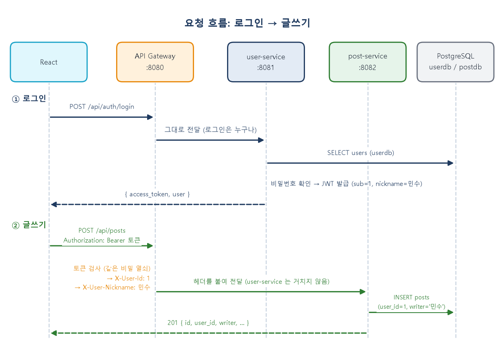
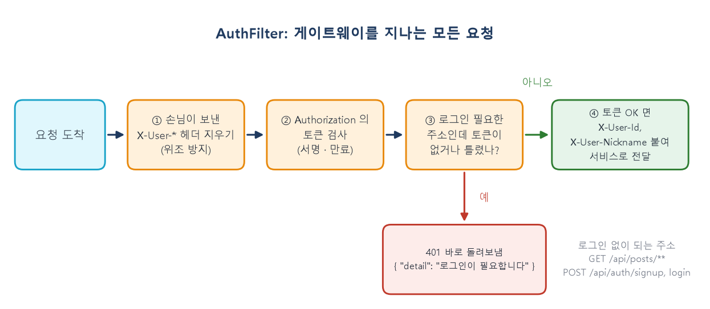

# 6장. api-gateway - 라우팅과 인증을 정문에서

## 학습 목표

- Spring Cloud Gateway 로 **주소에 따라 다른 서비스로 전달(라우팅)** 한다.
- `GlobalFilter` 로 **모든 요청의 토큰을 한 곳에서** 검사하고, 결과를 헤더로 넘긴다.
- 헤더 위조를 막는 방법, CORS 를 정문에서 처리하는 이유, 서비스 장애 때의 응답을 안다.

## 6-1. 게이트웨이가 하는 일



그림의 ② 글쓰기를 보자. 게이트웨이는 토큰을 검사한 뒤 **user-service 를 거치지 않고** 바로 post-service 로 보낸다. 토큰 서명만 확인하면 누구인지 알 수 있기 때문이다.

| 일 | 어디에 | 코드 양 |
|---|---|---|
| ① 라우팅 (`/api/auth/**` → 8081, `/api/posts/**` → 8082) | `application.yml` | 설정 몇 줄 |
| ② CORS (React 5173 허락) | `application.yml` | 설정 몇 줄 |
| ③ 토큰 검사 → `X-User-Id`, `X-User-Nickname` 헤더 | `AuthFilter.java`, `JwtChecker.java` | 파일 2개 |
| ④ 서비스가 꺼졌을 때 503 JSON | `GatewayErrorHandler.java` | 파일 1개 |

```text
api-gateway/src/main/java/com/example/gateway
├─ GatewayApplication.java     시작점 (8080)
├─ AuthFilter.java             모든 요청의 토큰 검사
├─ JwtChecker.java             토큰 서명·만료 확인
└─ GatewayErrorHandler.java    오류 → {"detail": ...}
```

## 6-2. 라이브러리

<!-- file: backend/api-gateway/build.gradle -->

```groovy
// build.gradle (api-gateway) - 게이트웨이에 필요한 라이브러리
//
//   spring-cloud-starter-gateway-server-webflux : Spring Cloud Gateway
//       들어온 요청을 주소 규칙(routes)에 따라 다른 서버로 "전달" 해 주는 프로그램.
//       application.yml 에 규칙만 적으면 전달 코드는 직접 짤 필요가 없다.
//   jjwt : 로그인 토큰이 진짜인지 "검사" 한다 (토큰을 만드는 쪽은 user-service)
//
// DB 관련 라이브러리가 없다 → 게이트웨이는 데이터를 저장하지 않는다.
// 웹 MVC 대신 WebFlux 기반이라 코드에 Mono 라는 낯선 이름이 조금 나온다 (AuthFilter 주석 참고).

dependencies {
	implementation 'org.springframework.cloud:spring-cloud-starter-gateway-server-webflux'
	implementation 'io.jsonwebtoken:jjwt-api:0.13.0'
	runtimeOnly 'io.jsonwebtoken:jjwt-impl:0.13.0'
	runtimeOnly 'io.jsonwebtoken:jjwt-jackson:0.13.0'
}

// Spring Cloud 라이브러리 묶음의 버전 (Spring Boot 4.0 ~ 4.1 과 짝이 맞는 버전)
//   위에서 gateway 라이브러리 버전을 적지 않아도 이 묶음이 알맞은 버전을 골라 준다.
dependencyManagement {
	imports {
		mavenBom 'org.springframework.cloud:spring-cloud-dependencies:2025.1.5'
	}
}
```

**Spring Cloud** 는 Spring Boot 위에서 MSA 를 만들 때 쓰는 도구 모음이다. Gateway 말고도 서비스 찾기(Eureka), 설정 서버(Config) 등이 있다. 버전은 Spring Boot 버전과 짝을 맞춰야 하므로 `mavenBom` 으로 묶음 버전(2025.1.5)을 지정한다.

> **WebFlux 라는 말이 보인다.** 게이트웨이는 아주 많은 요청을 동시에 넘겨줘야 하므로, 지금까지 쓴 Web MVC 대신 **WebFlux**(적은 스레드로 많은 요청을 처리하는 방식)로 만들어져 있다. 그래서 코드에 `Mono` 같은 낯선 이름이 조금 나온다. 이 교안에서는 "나중에 끝나는 작업을 돌려준다" 정도로만 이해해도 충분하다.

## 6-3. application.yml - 라우팅과 CORS

<!-- file: backend/api-gateway/src/main/resources/application.yml -->

```yaml
# application.yml - API 게이트웨이 설정
#
# [MSA 개념] API 게이트웨이 = 모든 요청이 들어오는 "정문"
#   React 는 서비스가 몇 개인지, 각각 몇 번 포트인지 몰라도 된다. 항상 8080 하나로만 요청한다.
#   게이트웨이가 주소를 보고 알맞은 서비스로 전달해 준다 (라우팅).
#
#     React ── http://localhost:8080/api/auth/login ──▶ 게이트웨이 ──▶ user-service (8081)
#     React ── http://localhost:8080/api/posts      ──▶ 게이트웨이 ──▶ post-service (8082)

server:
  port: 8080                     # 모놀리식 판의 서버와 같은 포트 → React 의 API_URL 을 바꿀 필요가 없다

spring:
  application:
    name: api-gateway
  cloud:
    gateway:
      server:
        webflux:
          # ---- 1. 라우팅 규칙: "이런 주소(predicates)는 저기(uri)로 보내라" ----
          routes:
            - id: user-service
              uri: ${USER_SERVICE_URL:http://localhost:8081}
              predicates:
                - Path=/api/auth/**          # 회원가입 · 로그인 · 내 정보
            - id: post-service
              uri: ${POST_SERVICE_URL:http://localhost:8082}
              predicates:
                - Path=/api/posts/**         # 게시글 (/api/posts 자체도 포함된다)

          # ---- 2. CORS: React 개발 서버(5173)에서 오는 요청 허락 ----
          #   브라우저는 정문(게이트웨이)만 보므로 CORS 도 여기 한 곳에서만 설정한다.
          #   (각 서비스에는 CORS 설정이 없다)
          globalcors:
            cors-configurations:
              '[/api/**]':
                allowed-origins:
                  - http://localhost:5173
                  - http://127.0.0.1:5173
                allowed-methods: [GET, POST, PUT, DELETE]
                allowed-headers: "*"     # Authorization 헤더(토큰)도 보낼 수 있게

# JWT 설정 - user-service 의 jwt.secret 과 반드시 같은 값이어야 한다
#   (user-service 가 이 열쇠로 서명한 토큰을, 게이트웨이가 같은 열쇠로 검사한다)
jwt:
  secret: ${JWT_SECRET:dev-only-secret-change-me-0123456789abcdef}
```

**routes** 는 "이 주소(predicates)로 온 요청은 저기(uri)로 보내라" 는 규칙 목록이다.

| id | 이런 요청이 오면 (predicates) | 여기로 보낸다 (uri) |
|---|---|---|
| user-service | `Path=/api/auth/**` | `http://localhost:8081` |
| post-service | `Path=/api/posts/**` | `http://localhost:8082` |

주소는 바꾸지 않고 그대로 전달한다. 예를 들어 `http://localhost:8080/api/posts/3` 은 `http://localhost:8082/api/posts/3` 으로 간다.

> **[MSA 개념] 서비스 주소는 게이트웨이만 안다.**
>
> 게시글 서비스를 8082 에서 9000 으로 옮겨도 React 는 고칠 게 없다. 게이트웨이의 `uri` 한 줄만 바꾸면 된다. 서비스가 두 대로 늘어나도 마찬가지다. 바깥(React)과 안쪽(서비스)이 정문을 사이에 두고 떨어져 있다.

**globalcors** - 브라우저가 보는 서버는 게이트웨이 하나다. 그래서 CORS 도 정문 **한 곳에서만** 설정한다. 서비스들에는 CORS 설정이 없다. (서비스에도 CORS 를 켜면 응답에 CORS 헤더가 두 번 붙을 수 있고, 그러면 브라우저가 오히려 거부한다)

> **"CORS 를 게이트웨이에서 하니 서비스는 아무나 부를 수 있나?"** CORS 는 **브라우저**가 지키는 규칙이라 PowerShell 이나 다른 서버의 요청은 막지 못한다. 서비스를 지키는 것은 CORS 가 아니라 "서비스 포트를 바깥에 열지 않는 것"(4장)과 게이트웨이의 토큰 검사다.

## 6-4. JwtChecker - 같은 열쇠로 검사

<!-- file: backend/api-gateway/src/main/java/com/example/gateway/JwtChecker.java -->

```java
package com.example.gateway;

import io.jsonwebtoken.Claims;
import io.jsonwebtoken.JwtException;
import io.jsonwebtoken.Jwts;
import io.jsonwebtoken.security.Keys;
import java.nio.charset.StandardCharsets;
import javax.crypto.SecretKey;
import org.springframework.beans.factory.annotation.Value;
import org.springframework.stereotype.Component;

/**
 * JwtChecker - JWT(로그인 토큰) "검사" 전용
 *
 * user-service 의 JwtProvider 가 만든 토큰을, 같은 비밀 열쇠(jwt.secret)로 검사한다.
 *   - 서명이 맞는가?  (누군가 토큰 내용을 몰래 고쳤다면 서명이 맞지 않는다)
 *   - 만료되지 않았는가?
 * 둘 다 통과하면 토큰 내용(Claims)을 돌려준다.
 *   claims.getSubject()              → "3"     (사용자 번호)
 *   claims.get("nickname", String.class) → "민수"  (닉네임)
 *
 * [MSA 개념] 게이트웨이는 userdb 를 보지 않는다. 서명만 확인하면 토큰을 믿을 수 있기 때문이다.
 */
@Component
public class JwtChecker {

	private final SecretKey key;

	public JwtChecker(@Value("${jwt.secret}") String secret) {
		this.key = Keys.hmacShaKeyFor(secret.getBytes(StandardCharsets.UTF_8));
	}

	/** 토큰이 올바르면 내용(Claims)을, 위조됐거나 만료됐으면 null 을 돌려준다 */
	public Claims check(String token) {
		try {
			return Jwts.parser().verifyWith(key).build()
					.parseSignedClaims(token) // 서명·만료를 검사한다. 문제가 있으면 JwtException
					.getPayload();
		} catch (JwtException | IllegalArgumentException e) {
			return null;
		}
	}
}
```

user-service 의 `JwtProvider` 는 토큰을 **만들고**, 게이트웨이의 `JwtChecker` 는 **검사한다**. 둘이 같은 `jwt.secret` 을 나눠 가졌으므로, 게이트웨이는 userdb 를 보지 않고도 "user-service 가 발급한 진짜 토큰" 인지 알 수 있다.

## 6-5. AuthFilter - 모든 요청의 정문 검사



<!-- file: backend/api-gateway/src/main/java/com/example/gateway/AuthFilter.java -->

```java
package com.example.gateway;

import io.jsonwebtoken.Claims;
import java.net.URLEncoder;
import java.nio.charset.StandardCharsets;
import org.springframework.cloud.gateway.filter.GatewayFilterChain;
import org.springframework.cloud.gateway.filter.GlobalFilter;
import org.springframework.core.Ordered;
import org.springframework.http.HttpHeaders;
import org.springframework.http.HttpMethod;
import org.springframework.http.HttpStatus;
import org.springframework.http.server.reactive.ServerHttpRequest;
import org.springframework.http.server.reactive.ServerHttpResponse;
import org.springframework.stereotype.Component;
import org.springframework.web.server.ServerWebExchange;
import reactor.core.publisher.Mono;

/**
 * AuthFilter - 게이트웨이를 지나가는 "모든" 요청의 로그인 토큰을 검사하는 필터
 *
 * [MSA 개념] 인증은 정문(게이트웨이)에서 한 번만
 *   서비스가 10개라도 토큰 검사 코드는 여기 한 곳에만 있다.
 *   검사를 통과한 요청에는 "누가 보냈는지" 를 헤더로 적어서 서비스에 넘긴다.
 *     X-User-Id       : 3
 *     X-User-Nickname : %EB%AF%BC%EC%88%98   ("민수". 헤더에는 한글을 바로 못 실어서 URL 인코딩)
 *   서비스는 이 헤더만 읽으면 된다 (토큰·Spring Security 를 몰라도 된다).
 *
 * 하는 일 (순서대로)
 *   1. 손님(브라우저)이 보낸 X-User-Id, X-User-Nickname 헤더는 지운다.
 *      → 누군가 "X-User-Id: 1" 을 직접 적어 보내 남인 척하는 것을 막는다. (헤더는 게이트웨이만 붙일 수 있다)
 *   2. "Authorization: Bearer <토큰>" 에서 토큰을 꺼내 검사한다.
 *   3. 로그인이 필요한 주소인데 올바른 토큰이 없으면 → 401 { "detail": "..." } 로 바로 돌려보낸다.
 *   4. 토큰이 올바르면 X-User-Id, X-User-Nickname 헤더를 붙여 서비스로 넘긴다.
 *
 * 로그인 없이 쓸 수 있는 주소
 *   GET  /api/posts, /api/posts/{id}           (글 읽기)
 *   POST /api/auth/signup, /api/auth/login      (가입, 로그인)
 *   그 밖 (글쓰기·수정·삭제, /api/auth/me) 은 로그인 필요
 *
 * 처음 보는 이름 정리 (게이트웨이는 WebFlux 라는 방식으로 동작한다)
 *   GlobalFilter         : 모든 경로(route)에 적용되는 게이트웨이 필터
 *   ServerWebExchange    : 요청(request) + 응답(response) 묶음
 *   Mono<Void>           : "나중에 끝나는 작업" 이라는 뜻. 지금은 "return chain.filter(...)" 또는
 *                          "return 응답쓰기" 둘 중 하나를 돌려준다고만 알면 충분하다.
 */
@Component
public class AuthFilter implements GlobalFilter, Ordered {

	private static final String USER_ID = "X-User-Id";
	private static final String USER_NICKNAME = "X-User-Nickname";

	private final JwtChecker jwtChecker;

	public AuthFilter(JwtChecker jwtChecker) {
		this.jwtChecker = jwtChecker;
	}

	@Override
	public Mono<Void> filter(ServerWebExchange exchange, GatewayFilterChain chain) {
		ServerHttpRequest request = exchange.getRequest();

		// 1. 손님이 보낸 X-User-* 헤더 지우기 (위조 방지)
		ServerHttpRequest.Builder newRequest = request.mutate()
				.headers(headers -> {
					headers.remove(USER_ID);
					headers.remove(USER_NICKNAME);
				});

		// 2. 토큰 꺼내서 검사
		String authorization = request.getHeaders().getFirst(HttpHeaders.AUTHORIZATION);
		boolean hasToken = authorization != null && authorization.startsWith("Bearer ");
		Claims claims = hasToken ? jwtChecker.check(authorization.substring(7)) : null; // "Bearer " 뒤의 글자

		// 3. 로그인이 필요한데 올바른 토큰이 없다 → 401
		if (claims == null && needsLogin(request)) {
			String message = hasToken ? "로그인이 만료되었습니다. 다시 로그인하세요" : "로그인이 필요합니다";
			return unauthorized(exchange, message);
		}

		// 4. 토큰이 올바르면 "누가 보냈는지" 헤더로 붙이기
		if (claims != null) {
			String nickname = claims.get("nickname", String.class);
			newRequest.header(USER_ID, claims.getSubject());
			newRequest.header(USER_NICKNAME, URLEncoder.encode(nickname, StandardCharsets.UTF_8)); // 민수 → %EB%AF%BC...
		}

		// 바뀐 요청으로 다음 단계(→ 서비스로 전달)를 진행한다
		return chain.filter(exchange.mutate().request(newRequest.build()).build());
	}

	/** 이 요청은 로그인이 필요한가? */
	private boolean needsLogin(ServerHttpRequest request) {
		HttpMethod method = request.getMethod();
		String path = request.getPath().value(); // 예: /api/posts/5

		if (method == HttpMethod.GET && path.startsWith("/api/posts")) {
			return false; // 글 읽기는 누구나
		}
		if (method == HttpMethod.POST && (path.equals("/api/auth/signup") || path.equals("/api/auth/login"))) {
			return false; // 가입·로그인은 누구나
		}
		return true; // 나머지는 로그인 필요
	}

	/** 401 응답을 { "detail": "..." } JSON 으로 바로 돌려준다 (서비스까지 가지 않는다) */
	private Mono<Void> unauthorized(ServerWebExchange exchange, String message) {
		ServerHttpResponse response = exchange.getResponse();
		response.setStatusCode(HttpStatus.UNAUTHORIZED);
		response.getHeaders().set(HttpHeaders.CONTENT_TYPE, "application/json;charset=UTF-8");
		byte[] body = ("{\"detail\":\"" + message + "\"}").getBytes(StandardCharsets.UTF_8);
		return response.writeWith(Mono.just(response.bufferFactory().wrap(body)));
	}

	/** 필터 순서. 숫자가 작을수록 먼저 실행된다 → 서비스로 전달하기 전에 반드시 먼저 검사 */
	@Override
	public int getOrder() {
		return -1;
	}
}
```

순서대로 읽어 보자.

1. **손님이 보낸 X-User-\* 헤더 지우기** - 서비스는 이 헤더를 믿는다(4장). 만약 누군가 브라우저에서 `X-User-Id: 1` 을 직접 적어 보내고 게이트웨이가 그대로 넘긴다면, 아무나 1번 회원 행세를 할 수 있다. 그래서 들어온 헤더는 **무조건 지우고**, 토큰을 검사한 게이트웨이만 새로 붙인다.
2. **토큰 검사** - `Authorization: Bearer <토큰>` 에서 토큰을 꺼내 `JwtChecker` 로 검사한다.
3. **로그인이 필요한데 토큰이 없거나 틀리면 401** - `needsLogin` 이 주소 규칙을 정한다. 글 읽기(GET `/api/posts/**`)와 가입·로그인만 누구나 쓸 수 있다. 응답은 서비스까지 가지 않고 게이트웨이가 바로 돌려준다.
4. **헤더 붙여 전달** - 토큰이 올바르면 `X-User-Id`, `X-User-Nickname` 을 붙여 서비스로 넘긴다.

> **[MSA 개념] 인증(Authentication)과 인가(Authorization)를 나눠 맡는다.**
> - **인증** = "누구세요?" → 게이트웨이가 토큰으로 확인 (401)
> - **인가** = "이 일을 해도 되나요?" → 데이터를 가진 서비스가 판단 (403, 남의 글)
>
> 서비스가 100개라도 토큰 검사 코드는 게이트웨이 한 곳에만 있다. 토큰 방식을 바꿀 때도 게이트웨이만 고치면 된다.

## 6-6. GatewayErrorHandler - 서비스가 꺼졌을 때

<!-- file: backend/api-gateway/src/main/java/com/example/gateway/GatewayErrorHandler.java -->

```java
package com.example.gateway;

import java.net.ConnectException;
import java.nio.charset.StandardCharsets;
import org.springframework.boot.webflux.error.ErrorWebExceptionHandler;
import org.springframework.core.annotation.Order;
import org.springframework.http.HttpHeaders;
import org.springframework.http.HttpStatus;
import org.springframework.http.server.reactive.ServerHttpResponse;
import org.springframework.stereotype.Component;
import org.springframework.web.server.ResponseStatusException;
import org.springframework.web.server.ServerWebExchange;
import reactor.core.publisher.Mono;
import reactor.netty.http.client.PrematureCloseException;

/**
 * GatewayErrorHandler - 게이트웨이에서 난 오류를 { "detail": "..." } JSON 으로 바꿔 준다
 *
 * [MSA 개념] 서비스 하나가 꺼져도 정문은 친절하게
 *   user-service 가 꺼진 채로 로그인하면, 게이트웨이는 전달할 곳에 연결하지 못한다(ConnectException).
 *   이 파일이 없으면 Spring 기본 모양 {"timestamp":..., "status":500, ...} 이 나가서
 *   React 화면에는 이유 없는 "요청 실패 (500)" 만 보인다.
 *   → 503(Service Unavailable, 서비스를 쓸 수 없음) + 한국어 이유로 바꿔 준다.
 *
 *   상황                                   상태 코드
 *   전달할 서비스에 연결 못 함 (꺼져 있음)      503 "서비스에 연결할 수 없습니다 ..."
 *   라우팅 규칙에 없는 주소 (/api/nothing)     404 "없는 주소입니다"
 *   그 밖의 오류                            500 "게이트웨이 오류가 났습니다"
 *
 * @Order(-2) : Spring 이 기본으로 넣어 둔 오류 처리기(-1)보다 먼저 실행되게 한다.
 */
@Component
@Order(-2)
public class GatewayErrorHandler implements ErrorWebExceptionHandler {

	@Override
	public Mono<Void> handle(ServerWebExchange exchange, Throwable ex) {
		ServerHttpResponse response = exchange.getResponse();
		if (response.isCommitted()) { // 응답을 이미 보내기 시작했으면 바꿀 수 없다
			return Mono.error(ex);
		}

		HttpStatus status;
		String message;
		if (isConnectionRefused(ex)) {
			status = HttpStatus.SERVICE_UNAVAILABLE;
			message = "서비스에 연결할 수 없습니다. 서비스가 켜져 있는지 확인하세요";
		} else if (ex instanceof ResponseStatusException e && e.getStatusCode().value() == 404) {
			status = HttpStatus.NOT_FOUND;
			message = "없는 주소입니다";
		} else {
			status = HttpStatus.INTERNAL_SERVER_ERROR;
			message = "게이트웨이 오류가 났습니다";
		}

		response.setStatusCode(status);
		response.getHeaders().set(HttpHeaders.CONTENT_TYPE, "application/json;charset=UTF-8");
		byte[] body = ("{\"detail\":\"" + message + "\"}").getBytes(StandardCharsets.UTF_8);
		return response.writeWith(Mono.just(response.bufferFactory().wrap(body)));
	}

	/**
	 * 오류의 원인을 거슬러 올라가며 "서비스에 닿지 못했다" 는 예외가 있는지 찾는다
	 *   ConnectException        : 연결 거부 (서비스가 꺼져 있음)
	 *   PrematureCloseException : 연결은 됐지만 응답 전에 끊김 (서비스가 꺼지는 중이거나, Docker 가 포트만 열어 둔 경우)
	 */
	private boolean isConnectionRefused(Throwable ex) {
		for (Throwable t = ex; t != null; t = t.getCause()) {
			if (t instanceof ConnectException || t instanceof PrematureCloseException) {
				return true;
			}
		}
		return false;
	}
}
```

user-service 가 꺼진 채로 로그인하면 게이트웨이는 전달할 곳에 연결하지 못한다. 이 파일이 없으면 Spring 기본 오류 모양이 나가서 React 화면에는 이유 없는 "요청 실패 (500)" 만 보인다. 이 파일이 있으면 **503 + 한국어 이유**가 `{"detail": ...}` 모양으로 나가므로, React 코드를 고치지 않아도 화면에 그대로 보인다. (7장에서 실험)

> **라우팅 규칙에 없는 주소는?** `GET /api/nothing` 처럼 어느 `routes` 에도 맞지 않는 요청은 `AuthFilter` 를 지나지 않는다. `GlobalFilter` 는 **경로가 정해진 요청**에만 실행되기 때문이다. 이런 요청은 게이트웨이가 바로 404 `없는 주소입니다` 로 응답한다.

## 6-7. 켜서 시험하기

IntelliJ 에서 `GatewayApplication` 을 ▶ 로 실행한다. 이제 **모든 요청은 8080 으로** 보낸다. 시험은 7장에서 React 와 PowerShell 로 한꺼번에 한다.

> **콘솔의 WARN 몇 줄은 괜찮다.** 게이트웨이를 켜면 `HV000271: Using @Valid on a container ... is deprecated` 같은 경고가 몇 줄 나온다. Spring Cloud Gateway 라이브러리 안쪽에서 나는 것이고 동작에는 문제가 없다. 마지막에 `Started GatewayApplication` 이 보이면 된다.

## 정리

- 라우팅과 CORS 는 `application.yml` 설정만으로 끝난다.
- `AuthFilter` 가 ① 위조 헤더 지우기 ② 토큰 검사 ③ 401 ④ `X-User-Id` · `X-User-Nickname` 붙이기를 한다.
- 인증(401)은 게이트웨이, 인가(403)는 데이터를 가진 서비스가 맡는다.
- 서비스가 꺼지면 `GatewayErrorHandler` 가 503 `{"detail": ...}` 로 알려 준다.

## 확인 문제

1. `AuthFilter` 가 손님이 보낸 `X-User-Id` 헤더를 지우지 않으면 어떤 일이 생길 수 있는가?
2. 게시글 서비스를 9000 번 포트로 옮겼다. 무엇을 고쳐야 하는가? React 는?
3. 게이트웨이와 user-service 의 `jwt.secret` 이 서로 다르면 로그인 뒤 글쓰기에서 어떤 응답이 올까?
4. CORS 를 게이트웨이에서만 설정하는 이유는?
