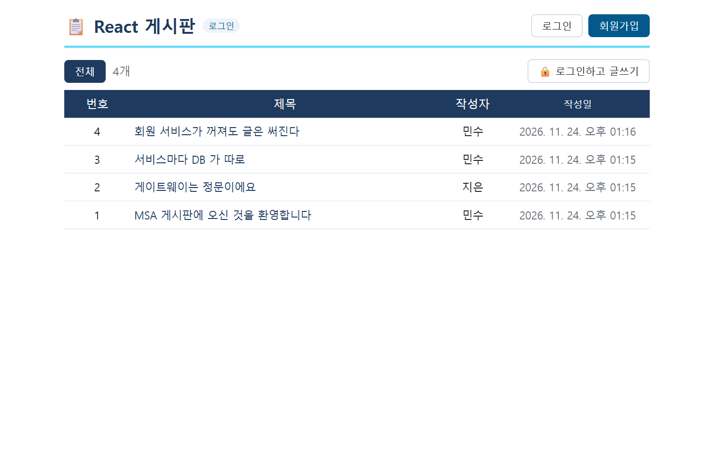
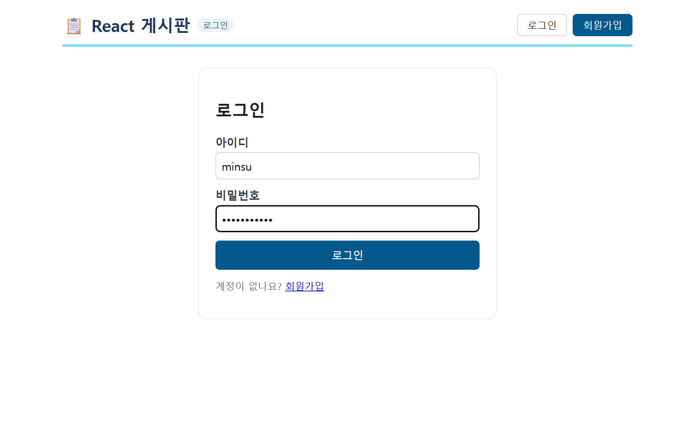
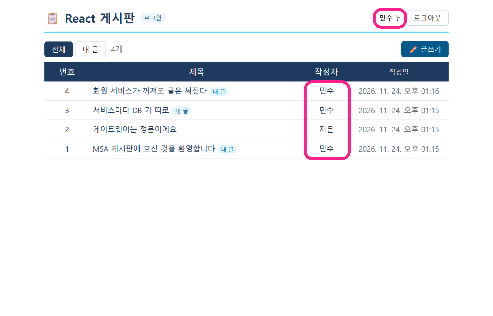
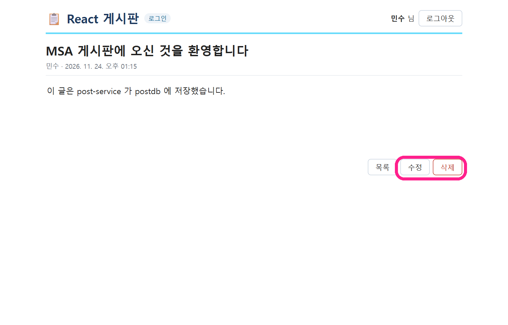
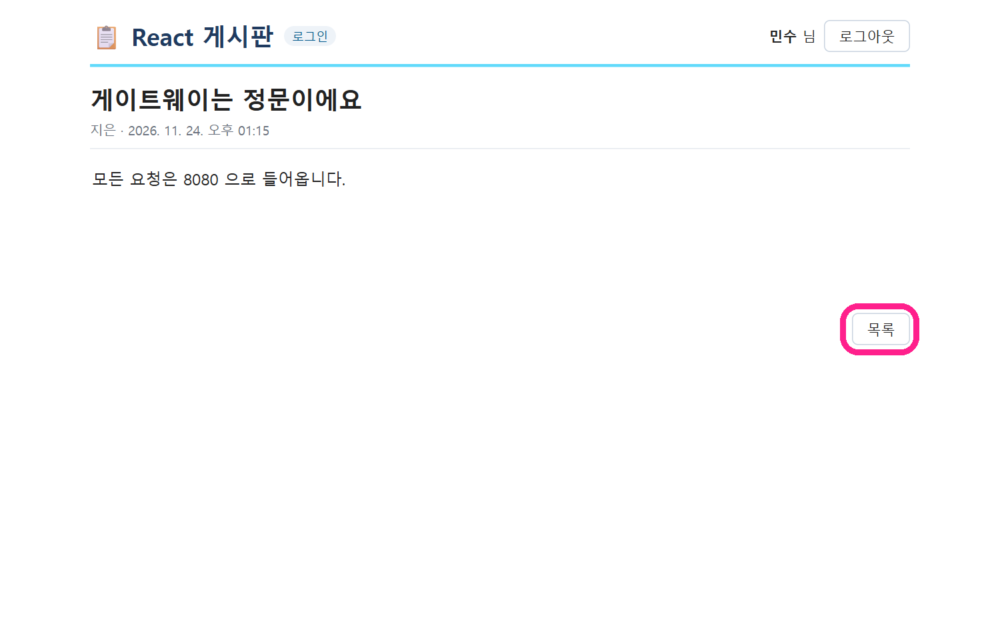
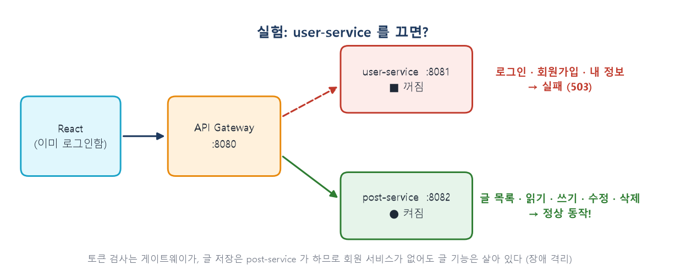
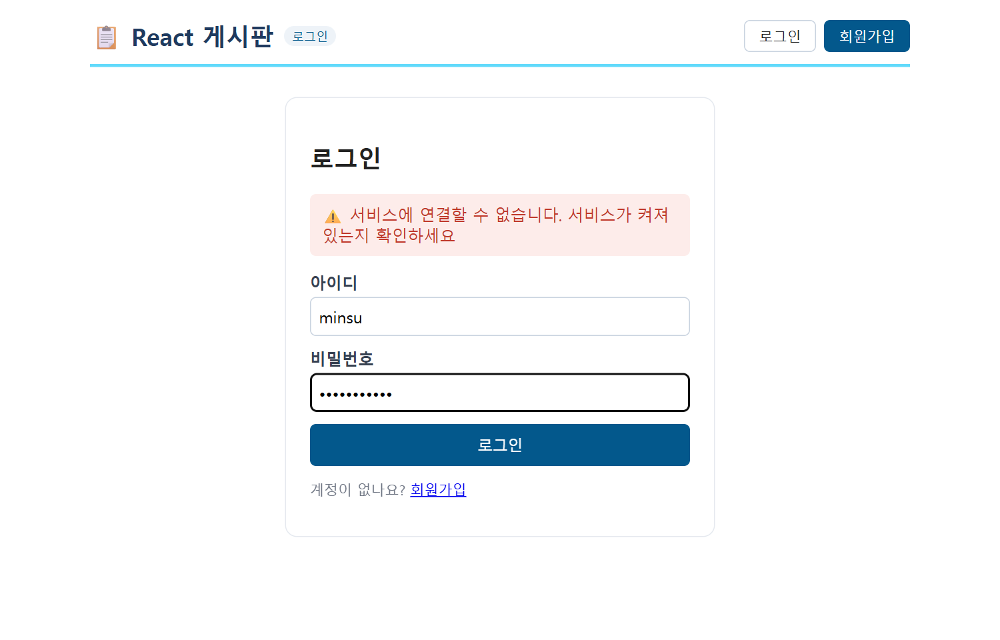

# 7장. 전체 실행, React 연결, 장애 실험

## 학습 목표

- DB → 서비스 → 게이트웨이 → React 순서로 전체를 켠다.
- React 화면과 PowerShell 로 가입·로그인·글 CRUD·401·403 을 확인한다.
- 서비스 하나를 꺼 보며 **장애 격리**를 직접 확인한다.

## 7-1. 켜는 순서

| 순서 | 무엇을 | 어떻게 | 확인 |
|---|---|---|---|
| 1 | DB | `docker compose up -d` (저장소 폴더) | `docker compose ps` → healthy |
| 2 | user-service | IntelliJ `UserServiceApplication` ▶ | `Started UserServiceApplication` |
| 3 | post-service | IntelliJ `PostServiceApplication` ▶ | `Started PostServiceApplication` |
| 4 | api-gateway | IntelliJ `GatewayApplication` ▶ | `Started GatewayApplication` |
| 5 | React | 아래 명령 | http://localhost:5173 |

2·3·4 는 순서가 바뀌어도 괜찮다. 서비스끼리 켜질 때 서로를 부르지 않기 때문이다. 다만 **DB 는 먼저** 켜야 한다. user-service 와 post-service 가 켜지면서 DB 에 접속하기 때문이다.

**[PS]** React - 처음 한 번만 `npm install`

```powershell
cd C:\study\react-spring-mas-postgresql\frontend   # React 폴더 (backend 가 아니다)
npm install       # 처음 한 번만: package.json 의 라이브러리를 node_modules 로 받는다 (1~2분)
npm run dev       # 개발 서버 켜기 → http://localhost:5173 (끌 때는 Ctrl+C)
```

> **[MSA 개념] React 코드는 React 심화 과정과 같다.** `frontend/src/api.js` 의 `API_URL` 은 여전히 `http://localhost:8080/api` 다. 그 뒤에 서버가 몇 개로 나뉘었는지 React 는 모른다. 바뀐 것은 주석 몇 줄뿐이다.

## 7-2. React 로 확인하기

http://localhost:5173 을 연다. 처음에는 글이 없다. **회원가입**으로 `minsu`(민수)와 `jieun`(지은) 두 사람을 만들고(비밀번호는 둘 다 `password123`), 각자 로그인해서 글을 몇 개 써 보자. 4장에서 minsu 를 이미 만들었다면 jieun 만 가입하고, minsu 는 로그인만 한다. **두 사람 모두 글을 하나 이상** 써 두어야 7-3 의 "남의 글 삭제" 를 해 볼 수 있다.











화면은 React 심화 과정과 똑같다. 하지만 요청 하나하나가 이렇게 흘러간다.

| 화면에서 한 일 | 게이트웨이 | 도착한 서비스 | DB |
|---|---|---|---|
| 목록 보기 | 토큰 없어도 통과 | post-service | postdb |
| 로그인 | 통과 | user-service | userdb |
| 머리글의 "민수 님" (`/api/auth/me`) | 토큰 검사 → `X-User-Id` | user-service | userdb |
| 글쓰기 | 토큰 검사 → `X-User-Id`, `X-User-Nickname` | post-service | postdb |
| 남의 글 삭제 (직접 요청) | 토큰 검사 통과 | post-service → **403** | postdb |

## 7-3. PowerShell 로 확인하기

화면 단추로는 해 볼 수 없는 요청(남의 글 삭제, 헤더 위조)도 직접 보내 보자. 모든 요청은 **8080(게이트웨이)** 으로 보낸다. 아래 결과의 번호(`id`)는 예시다. 글을 몇 개 썼는지에 따라 내 화면과 다를 수 있다.

**[PS]** 먼저 오류 응답을 보기 좋게 찍어 주는 함수를 만든다. (4장에서 만든 것과 같다. PowerShell 창을 새로 열었다면 다시 붙여 넣는다)

```powershell
# 오류가 나면 "상태코드 {"detail": "..."}" 모양으로 보여 주는 함수
function Show-Error($err) {                     # $err: catch 에서 받은 오류 ($_)
  # PowerShell 7 은 응답 본문을 ErrorDetails 에 넣어 준다
  if ($err.ErrorDetails.Message) { $body = $err.ErrorDetails.Message }
  else {
    # Windows PowerShell 5.1 은 응답 스트림을 직접 UTF-8 로 읽어야 한글이 깨지지 않는다
    $reader = New-Object System.IO.StreamReader($err.Exception.Response.GetResponseStream(), [System.Text.Encoding]::UTF8)
    $body = $reader.ReadToEnd()
  }
  "$([int]$err.Exception.Response.StatusCode) $body"   # 예: 401 {"detail":"로그인이 필요합니다"}
}
$api = "http://localhost:8080/api"      # 모든 요청은 게이트웨이(8080)로 보낸다
```

**[PS]** ① 로그인해서 토큰 받기 (7-2 에서 만든 minsu 계정)

```powershell
# 로그인 요청 → 응답(access_token, user)을 $login 에 담는다. charset=utf-8 을 붙여야 한글이 깨지지 않는다
$login = Invoke-RestMethod -Method Post -Uri "$api/auth/login" -ContentType "application/json; charset=utf-8" -Body '{"username":"minsu","password":"password123"}'
$login.user                                                   # 로그인한 사람 정보 (id, username, nickname)
# 다음 요청마다 붙일 헤더: Authorization: Bearer <토큰>
$headers = @{ Authorization = "Bearer " + $login.access_token }
```

```text
id username nickname
-- -------- --------
 1 minsu    민수
```

**[PS]** ② 글쓰기 - 작성자는 토큰 주인(민수)

```powershell
# 토큰을 붙여 글쓰기 → 게이트웨이가 토큰을 확인하고 X-User-Id, X-User-Nickname 을 붙여 post-service 로 보낸다
$post = Invoke-RestMethod -Method Post -Uri "$api/posts" -Headers $headers -ContentType "application/json; charset=utf-8" -Body '{"title":"파워셸로 쓴 글","content":"게이트웨이 통과"}'
$post                      # 저장된 글 - writer 가 민수다 (Body 에 writer 를 보내지 않았는데도)
```

```text
id         : 4
user_id    : 1
writer     : 민수
title      : 파워셸로 쓴 글
content    : 게이트웨이 통과
...
```

**[PS]** ③ 헤더 위조 - 토큰 없이 `X-User-Id: 1` 만 적어 보내기

```powershell
# 토큰 없이 X-User-Id 만 직접 적어 보내기 → 게이트웨이가 401 로 막아야 한다
try { Invoke-RestMethod -Method Post -Uri "$api/posts" -ContentType "application/json; charset=utf-8" -Body '{"title":"x"}' -Headers @{ "X-User-Id" = "1" } } catch { Show-Error $_ }
```

```text
401 {"detail":"로그인이 필요합니다"}
```

게이트웨이가 손님이 보낸 `X-User-Id` 를 지우고, 토큰이 없으니 401 로 돌려보냈다. (6장 `AuthFilter` ①, ③)

**[PS]** ④ 남의 글 삭제 - 목록에서 민수가 쓰지 않은 글(지은의 글)을 하나 골라 지워 본다

```powershell
# 글 목록에서 user_id 가 내 번호가 아닌 글 하나 고르기
$other = (Invoke-RestMethod "$api/posts") | Where-Object { $_.user_id -ne $login.user.id } | Select-Object -First 1
$other.id, $other.writer                                       # 고른 글의 번호와 작성자 (지은)
# 민수의 토큰으로 지은의 글 삭제 → post-service 가 403 으로 막아야 한다
try { Invoke-RestMethod -Method Delete -Uri "$api/posts/$($other.id)" -Headers $headers } catch { Show-Error $_ }
```

`$other` 가 비어 있다면 지은의 글이 없는 것이다. 7-2 로 돌아가 지은으로 글을 하나 쓰고 다시 해 보자.

```text
403 {"detail":"본인이 쓴 글만 수정·삭제할 수 있습니다"}
```

이번에는 토큰이 올바르니 게이트웨이를 통과했고, **post-service** 가 글 주인을 비교해 403 을 돌려줬다.

**[PS]** ⑤ 내 글 삭제

```powershell
Invoke-RestMethod -Method Delete -Uri "$api/posts/$($post.id)" -Headers $headers    # ②에서 쓴 내 글 삭제 → 성공 (아무것도 안 찍히면 정상)
Invoke-RestMethod -Uri "$api/posts" | Format-Table id, user_id, writer, title      # 남은 글 목록을 표로
```

> **PowerShell 에서 한글이 깨진다면** - Windows PowerShell 5.1 은 응답에 글자 코드(charset)가 없으면 한글을 잘못 읽는다. 그래서 두 서비스의 `application.yml` 에 `spring.servlet.encoding.force-response: true` 를 넣어 `application/json;charset=UTF-8` 로 응답하게 했다. 요청 본문은 `-ContentType "application/json; charset=utf-8"` 로 보낸다.

## 7-4. 데이터는 어디에 있을까

**[PS]**

```powershell
docker exec mas-db psql -U postgres -d userdb -c "select id, username, nickname from users"      # 회원은 userdb 에
docker exec mas-db psql -U postgres -d postdb -c "select id, user_id, writer, title from posts"   # 글은 postdb 에 (user_id·writer 는 복사해 둔 값)
```

```text
 id | username | nickname
----+----------+----------
  1 | minsu    | 민수
  2 | jieun    | 지은

 id | user_id | writer |              title
----+---------+--------+----------------------------------
  1 |       1 | 민수   | MSA 게시판에 오신 것을 환영합니다
  2 |       2 | 지은   | 게이트웨이는 정문이에요
  3 |       1 | 민수   | 서비스마다 DB 가 따로
```

회원은 `userdb`, 글은 `postdb` 에 있다. `posts.writer` 에 닉네임이 **복사되어** 있는 것도 보인다.

## 7-5. 장애 실험 - user-service 를 꺼 보자



React 에서 **민수로 로그인한 상태**로 둔다. 그리고 IntelliJ 의 서비스(Services) 창(3장 3-5 의 마지막 그림)에서 **user-service 만 멈춘다**(■).

**① 글은 그대로 된다** - 화면 위쪽의 **내 글**, **전체** 단추를 차례로 눌러 목록을 다시 불러오고, **글쓰기**로 글을 하나 써 보자. 잘 된다. 토큰 검사는 게이트웨이가, 글 저장은 post-service 가 하므로 user-service 가 없어도 된다. (이때 브라우저 새로고침(F5)은 누르지 않는다. 아래 상자 참고)

> **F5(새로고침)를 누르면 로그아웃된다 - 왜?**
>
> React 앱은 새로 열릴 때 저장해 둔 토큰이 아직 쓸 만한지 `GET /api/auth/me` 로 확인한다(`AuthContext.jsx`). 이 요청은 **user-service** 가 받는데, 꺼져 있으니 503 이 오고, React 는 확인에 실패한 토큰을 지우고 로그인 화면으로 보낸다.
>
> 서버를 나눠도 **화면이 어떤 서비스에 기대고 있는지**에 따라 장애가 번질 수 있다는 뜻이다. "401 일 때만 토큰을 지우고, 503 처럼 서버가 잠깐 아플 때는 토큰을 남겨 두기" 처럼 React 쪽도 함께 고민해야 한다. (도전 과제로 `AuthContext.jsx` 의 `.catch` 를 고쳐 보자)

**② 로그인은 안 된다** - 로그아웃하고 다시 로그인해 보자.



**[PS]** 같은 일을 PowerShell 로 - `$headers` 에는 7-3 에서 받아 둔 토큰이 들어 있다 (user-service 를 끄기 **전에** 받은 토큰이라 아직 쓸 수 있다)

```powershell
# user-service 가 꺼진 상태에서 로그인 → 게이트웨이가 503 을 돌려준다
try { Invoke-RestMethod -Method Post -Uri "$api/auth/login" -ContentType "application/json; charset=utf-8" -Body '{"username":"minsu","password":"password123"}' } catch { Show-Error $_ }
# 미리 받아 둔 토큰으로 글쓰기 → post-service 는 살아 있으니 성공한다 (장애 격리)
Invoke-RestMethod -Method Post -Uri "$api/posts" -Headers $headers -ContentType "application/json; charset=utf-8" -Body '{"title":"회원 서비스가 꺼져도 글은 써진다","content":"장애 격리"}'
```

```text
503 {"detail":"서비스에 연결할 수 없습니다. 서비스가 켜져 있는지 확인하세요"}

id      : 5
user_id : 1
writer  : 민수
title   : 회원 서비스가 꺼져도 글은 써진다
...
```

> **[MSA 개념] 장애 격리(Fault Isolation)**
>
> 모놀리식이었다면 서버가 하나라서 "회원 기능만 끄기" 가 불가능하고, 서버가 죽으면 전부 멈춘다. MSA 에서는 **꺼진 서비스의 기능만** 멈추고 나머지는 계속 돈다. 쇼핑몰이라면 "리뷰 서비스가 고장 나도 결제는 된다" 는 뜻이다.
>
> 반대로 **게이트웨이가 꺼지면 모든 요청이 멈춘다.** 정문이 하나뿐이기 때문이다. 그래서 실제 운영에서는 게이트웨이를 여러 대 띄운다.

실험이 끝나면 user-service 를 다시 켠다(▶). 다시 로그인이 된다. **다른 서비스는 다시 켤 필요가 없다.**

## 정리

- 켜는 순서: **DB → 서비스들(순서 무관) → 게이트웨이 → React**.
- 401 은 게이트웨이, 403 은 post-service 가 돌려준다. 위조한 `X-User-Id` 는 게이트웨이에서 지워진다.
- user-service 가 꺼져도 글 기능은 살아 있다(장애 격리). 게이트웨이는 503 으로 이유를 알려 준다.

## 확인 문제

1. user-service 를 끈 상태에서, 이미 로그인한 사람이 글을 쓸 수 있는 이유는?
2. 이번에는 post-service 만 끈다. 로그인은 될까? 글 목록은? 직접 해 보고 결과를 적어 보자.
3. 게이트웨이를 끄면 어떻게 될까? 실제 운영에서는 이 문제를 어떻게 줄일까?
