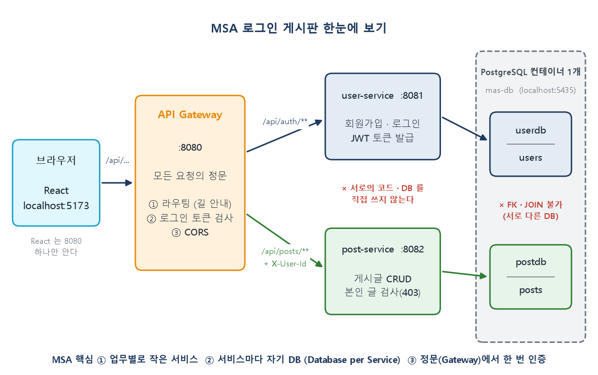

# 8장. 정리와 더 나아가기

## 학습 목표

- 이 교안에서 만든 MSA 구조를 처음부터 끝까지 설명할 수 있다.
- 실제 MSA 에서 더 필요한 것들(서비스 찾기, 이벤트, 분산 추적 ...)의 이름과 하는 일을 안다.

## 8-1. 한 장으로 다시 보기

| 질문 | 이 교안의 답 |
|---|---|
| 서비스는 몇 개? | 게이트웨이 1 + 업무 서비스 2 (회원, 게시글) |
| React 는 어디로 요청하나? | 게이트웨이(8080) 하나 |
| 로그인 검사는 누가? | 게이트웨이의 `AuthFilter` (401) |
| 남의 글 검사는 누가? | 데이터를 가진 post-service (403) |
| 서비스는 누가 보냈는지 어떻게 아나? | 게이트웨이가 붙인 `X-User-Id`, `X-User-Nickname` 헤더 |
| DB 는? | 컨테이너 1개, 데이터베이스 2개 (`userdb`, `postdb`) |
| 다른 DB 의 데이터가 필요하면? | FK·JOIN 대신 필요한 값을 **복사** (`posts.writer`) |
| 서비스 하나가 꺼지면? | 그 기능만 멈춘다 (장애 격리), 게이트웨이는 503 |

## 8-2. 모놀리식 판과 코드 비교

| 모놀리식 (react-spring-postgresql) | MSA (이 저장소) |
|---|---|
| `SecurityConfig.java` | 게이트웨이 `AuthFilter.needsLogin()` + `application.yml` 의 CORS |
| `JwtAuthenticationFilter.java` | 게이트웨이 `AuthFilter.java` |
| `JwtProvider.java` (발급 + 검사) | user-service `JwtProvider` (발급) + 게이트웨이 `JwtChecker` (검사) |
| `LoginUser` + `@AuthenticationPrincipal` | `@RequestHeader("X-User-Id")` |
| `Post.author` (`@ManyToOne User`) | `Post.userId` + `Post.writer` |
| `PostRepository` 의 `@EntityGraph` | 필요 없음 (JOIN 없음) |
| `PostService` 의 `UserRepository` | 필요 없음 |
| DB `authboard` (5434) | DB `userdb`, `postdb` (5435) |

## 8-3. 실제 MSA 에서 더 쓰는 것들

이 교안은 MSA 의 **기본 생각**만 담았다. 실제 서비스에서는 아래 도구들을 더한다. 이름과 하는 일만 알아 두자.

| 이름 | 하는 일 | 이 교안에서는 |
|---|---|---|
| **서비스 찾기** (Eureka, Consul) | 서비스 주소를 자동으로 등록·조회. 서비스가 여러 대로 늘어도 게이트웨이가 알아서 나눠 보낸다 | `uri: http://localhost:8081` 로 직접 적음 |
| **설정 서버** (Spring Cloud Config) | 여러 서비스의 설정(`jwt.secret` 등)을 한 곳에서 관리 | 두 `application.yml` 에 같은 값을 적음 |
| **이벤트 / 메시지 큐** (Kafka, RabbitMQ) | "닉네임이 바뀌었다", "회원이 탈퇴했다" 같은 소식을 다른 서비스에 알림 | 닉네임 변경·탈퇴 기능 없음 → **MSA 심화 교안**에서 Kafka 로 직접 만든다 |
| **서비스 간 API 호출** (RestClient, OpenFeign) | 서비스가 다른 서비스의 API 를 직접 부름 | 토큰에 닉네임을 실어 호출을 없앰 |
| **회로 차단기** (Resilience4j) | 고장 난 서비스로 계속 요청하지 않고 바로 대체 응답 | 없음. 요청마다 연결을 시도하고, 실패하면 `GatewayErrorHandler` 가 503 으로 알려 줄 뿐 |
| **분산 추적** (Zipkin, Micrometer Tracing) | 요청 하나가 여러 서비스를 지나간 길을 한눈에 봄 | 서비스마다 콘솔 로그 |
| **컨테이너 배포** (Docker, Kubernetes) | 서비스마다 컨테이너로 만들어 따로 배포·확장 | IntelliJ 에서 ▶ 로 실행 |

> **[MSA 개념] 분산 트랜잭션은 어렵다.**
>
> 모놀리식에서는 "회원 탈퇴 + 그 사람 글 삭제" 를 `@Transactional` 하나로 묶을 수 있었다. 지금은 두 DB 가 다른 서비스에 있어서 하나의 트랜잭션으로 묶을 수 없다. 실제 서비스에서는 **이벤트를 주고받으며 각자 처리하고, 실패하면 되돌리는 작업을 따로 실행**하는 방식(Saga 패턴)을 쓴다. MSA 를 도입할 때 가장 신중하게 고민해야 하는 부분이다.

## 8-4. 도전 과제

1. **post-service 만 끄기** - 7장의 실험을 post-service 로 해 보고, 무엇이 되고 무엇이 안 되는지 표로 정리하자.
2. **글 개수 보여 주기** - user-service 의 `/api/auth/me` 응답에 "내가 쓴 글 수" 를 넣고 싶다. user-service 는 postdb 를 볼 수 없다. 어떤 방법이 있을까? (힌트: post-service 에 `GET /api/posts?user_id=1` 이 이미 있다. 누가 이 API 를 부를지 정해 보자)
3. **댓글 서비스 설계** - `comment-service` 를 추가한다면 포트, DB 이름, 게이트웨이 라우팅 규칙, 필요한 헤더를 적어 보자. (코드는 post-service 를 복사해서 시작하면 된다)
4. **새로고침해도 로그인 유지하기** - 7장에서 user-service 를 끄고 F5 를 누르면 로그아웃됐다. `frontend/src/context/AuthContext.jsx` 의 `.catch(() => api.tokenStore.clear())` 를 "401 일 때만 토큰을 지운다" 로 고쳐 보자. (힌트: `.catch((e) => { if (e.status === 401) ... })`. 고친 뒤에도 user-service 가 꺼져 있으면 머리글에 이름은 안 보이지만, 다시 켜고 새로고침하면 로그인 상태가 돌아온다)
5. **DB 서버 나누기** - `docker-compose.yml` 에 PostgreSQL 컨테이너를 하나 더 만들고 post-service 를 그쪽으로 옮겨 보자. 서비스 코드에서 바뀌는 곳이 `application.yml` 한 줄뿐인지 확인하자.

## 정리

- MSA 는 **업무별 작은 서비스 + 서비스마다 자기 DB + 정문(게이트웨이)** 로 이루어진다.
- 얻는 것(따로 배포, 장애 격리, 부분 확장)과 잃는 것(복잡함, JOIN·트랜잭션의 어려움)을 함께 생각해야 한다.
- 실제 MSA 는 서비스 찾기, 이벤트, 분산 추적 같은 도구를 더해 이 생각을 키워 간다.

> **다음 단계 - MSA 심화 교안.** 5장에서 남긴 "닉네임을 바꿔도 예전 글 작성자는 그대로" 문제를 **Kafka 이벤트**로 푼다. 실습 코드는 저장소의 `advanced/` 폴더, 교안은 `React_Spring_MSA_심화_학습교안.pdf` 다.
